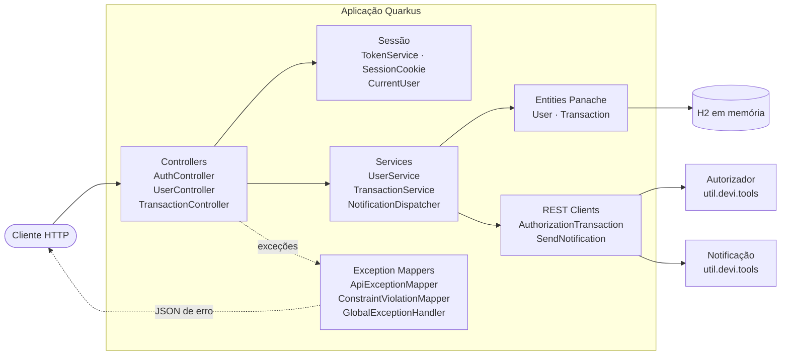
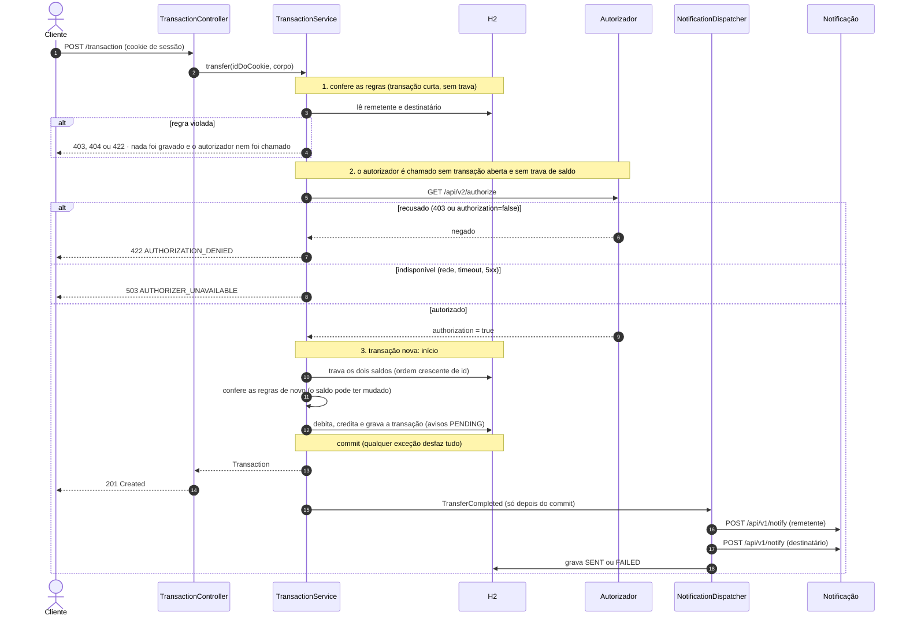
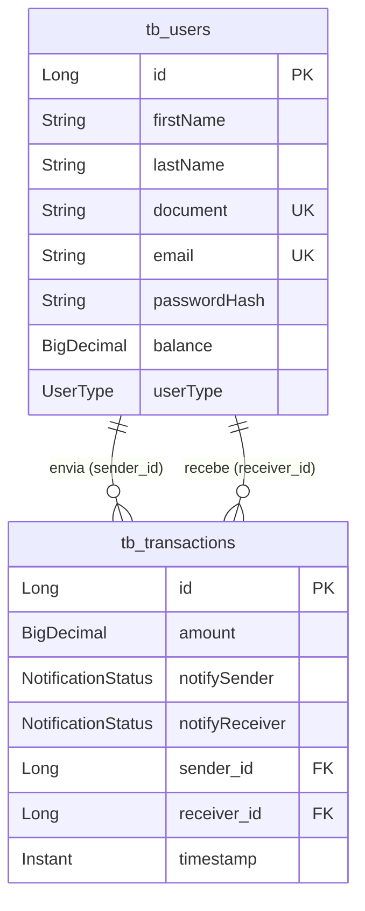

<div align="center">

<br>

# PicPay Simplificado

**API REST de carteira e transferências entre usuários, construída com Quarkus, e o front-end Arco, em React, servido pela mesma aplicação.**

Cadastro e login com sessão em cookie, busca de destinatário, transferências com autorização externa, notificação de quem envia e de quem recebe, e extrato. Débito, crédito e registro acontecem em uma única transação de banco de dados, com o saldo travado contra concorrência. O **Arco** é a interface: uma vitrine que conta a transferência em seis cenas e o app em que se envia o dinheiro.

<br>


<br>

[Visão geral](#visão-geral) ·
[Funcionalidades](#funcionalidades) ·
[Regras de negócio](#regras-de-negócio) ·
[Sessão e segurança](#sessão-e-segurança) ·
[Arquitetura](#arquitetura) ·
[Front-end](#front-end-arco) ·
[Execução](#instalação-e-execução) ·
[API](#referência-da-api) ·
[Limitações](#limitações-conhecidas) ·
[Roadmap](#roadmap)

<br>

</div>

---

## Sumário

- [Visão geral](#visão-geral)
- [Funcionalidades](#funcionalidades)
- [Regras de negócio](#regras-de-negócio)
- [Sessão e segurança](#sessão-e-segurança)
- [Arquitetura](#arquitetura)
- [Front-end (Arco)](#front-end-arco)
- [Tecnologias utilizadas](#tecnologias-utilizadas)
- [Pré-requisitos](#pré-requisitos)
- [Instalação e execução](#instalação-e-execução)
- [Configuração](#configuração)
- [Referência da API](#referência-da-api)
- [Persistência e modelo de dados](#persistência-e-modelo-de-dados)
- [Testes](#testes)
- [Estrutura de diretórios](#estrutura-de-diretórios)
- [Limitações conhecidas](#limitações-conhecidas)
- [Roadmap](#roadmap)
- [Como contribuir](#como-contribuir)
- [Licença](#licença)
- [Créditos](#créditos)

---

## Visão geral

O **PicPay Simplificado** é uma implementação do conhecido desafio técnico de back-end do PicPay: uma plataforma de pagamentos reduzida ao essencial, em que usuários têm uma carteira com saldo e podem transferir dinheiro entre si.

O problema central do desafio é **movimentar saldo entre duas contas de forma consistente**. Uma transferência só pode acontecer se o remetente tiver permissão e saldo, e se um serviço externo autorizar a operação. Se qualquer etapa falhar, nenhum saldo pode ser alterado.

### Como funciona

1. A pessoa cria a conta (`POST /auth/register`) com o perfil `COMMON` ou `MERCHANT`. O servidor define o saldo inicial de demonstração e já inicia a sessão, em um cookie.
2. Procura o destinatário por e-mail ou documento (`GET /users/search`).
3. Pede a transferência informando **só o destinatário e o valor**. O remetente é sempre quem está logado.
4. A aplicação valida as regras de negócio, trava os dois saldos e consulta o **serviço autorizador externo**. Se aprovada, debita o remetente, credita o destinatário e registra a transação, tudo em uma única transação de banco.
5. Depois do commit, o **serviço de notificação externo** é acionado para as duas pontas, de forma assíncrona. O resultado de cada aviso fica registrado na própria transação (`PENDING`, `SENT` ou `FAILED`).
6. O histórico é consultado em `GET /transaction`.

O **front-end Arco** (`frontend/`, React) percorre exatamente esse fluxo: a vitrine em `/`, o cadastro e o login, a carteira, o envio em três passos e o extrato. Ele é construído junto com a aplicação e servido por ela, na mesma origem; veja [Front-end (Arco)](#front-end-arco).

### Perfis de usuário

| Perfil | Valor do enum | Documento | Envia transferências | Recebe transferências | Saldo inicial |
| :--- | :--- | :--- | :---: | :---: | :--- |
| Usuário comum | `COMMON` | CPF | Sim | Sim | `app.signup.initial-balance` (padrão R$ 1.000,00) |
| Lojista | `MERCHANT` | CNPJ | Não | Sim | R$ 0,00 |

---

## Funcionalidades

| Funcionalidade | Endpoint |
| :--- | :--- |
| Cadastrar usuário (comum ou lojista) e iniciar a sessão | `POST /auth/register` |
| Entrar | `POST /auth/login` |
| Sair | `POST /auth/logout` |
| Ver o próprio perfil e saldo | `GET /users/me` |
| Buscar um destinatário por e-mail ou documento | `GET /users/search?q=` |
| Realizar transferência | `POST /transaction` |
| Consultar o extrato (paginado) | `GET /transaction` |
| Endpoint simples de verificação | `GET /hello` |
| Especificação OpenAPI gerada automaticamente | `GET /q/openapi` |
| Swagger UI (somente em modo de desenvolvimento e teste) | `GET /q/swagger-ui` |

O projeto **não** possui: atualização ou exclusão de usuários, recuperação de senha, estorno, depósito ou saque. As possibilidades de evolução estão no [Roadmap](#roadmap).

---

## Regras de negócio

**Cadastro.** O e-mail é guardado em minúsculas e o documento sem pontuação e em maiúsculas, e a unicidade vale sobre esses valores (então `ANA@x.com` e `ana@x.com`, `529.982.247-25` e `52998224725`, ou `12.abc.345/01de-35` e `12ABC34501DE35`, são a mesma conta). O documento precisa ser um **CPF válido** para `COMMON` e um **CNPJ válido** para `MERCHANT` (conferência dos dígitos verificadores); aceita a pontuação da máscara (`.`, `-`, `/` e espaços), e o que sobra tem de ser um documento: o CPF só tem dígitos, o CNPJ pode ter letras de `A` a `Z` (veja o **CNPJ alfanumérico**, logo abaixo), e texto em volta (`CPF: 529.982.247-25 ok`) ou letra acentuada é recusado. A senha tem no mínimo 8 caracteres e no máximo **72 bytes em UTF-8** (o limite do BCrypt, que guarda a senha): quem usa acentos ou emojis tem menos que 72 caracteres, e o formulário conta os bytes como o servidor. O saldo inicial é definido pelo servidor, nunca pelo cliente.

**CNPJ alfanumérico.** Desde julho de 2026 a Receita emite CNPJs com letras (IN RFB 2.229/2024); os numéricos que já existem continuam valendo. O CNPJ tem 14 caracteres: os 12 primeiros são algarismos ou letras de `A` a `Z`, e os dois últimos, os dígitos verificadores, são sempre algarismos (`12.ABC.345/01DE-35` é o exemplo oficial). O cálculo é o módulo 11 de sempre, com cada caractere valendo o código ASCII menos 48 (`0` a `9` valem 0 a 9 e `A` vale 17, e não 10 como em base 36), então a conta de um CNPJ numérico não muda. O documento é guardado normalizado e a busca de destinatário o acha digitado de qualquer jeito: com ou sem máscara, em maiúsculas ou minúsculas. A conversão para maiúsculas é só de `a` a `z`, no servidor e no formulário: a do Unicode transforma `ß` em `SS`, `ı` em `I` e `ſ` em `S`, e um texto com esses caracteres viraria um documento válido. No cadastro da loja o campo do CNPJ põe as letras em maiúsculas e o teclado do celular é o de texto; o do CPF continua numérico.

**Transferência.** As regras são verificadas nesta ordem:

| # | Regra | Resposta quando violada |
| :---: | :--- | :--- |
| 1 | `receiverId` e `amount` informados; `amount` maior que zero, com até 15 dígitos inteiros e 2 casas decimais | `400` · `VALIDATION_ERROR` (`REQUIRED`, `INVALID_AMOUNT`) |
| 2 | Remetente e destinatário são pessoas diferentes | `422` · `SELF_TRANSFER` |
| 3 | O destinatário existe | `404` · `USER_NOT_FOUND` |
| 4 | Lojistas (`MERCHANT`) não enviam | `403` · `MERCHANT_CANNOT_SEND` |
| 5 | O saldo do remetente cobre o valor | `422` · `INSUFFICIENT_BALANCE` |
| 6 | O autorizador externo responde com sucesso **e** `data.authorization == true` | `422` · `AUTHORIZATION_DENIED` (recusa) ou `503` · `AUTHORIZER_UNAVAILABLE` (fora do ar) |

Comportamentos adicionais:

- **Atomicidade.** Débito, crédito e registro são gravados numa transação só (`QuarkusTransaction.requiringNew`). Uma exceção em qualquer etapa dela provoca *rollback*, e nenhum saldo é alterado.
- **O autorizador é chamado fora da transação.** As regras 2 a 5 são conferidas primeiro, numa transação curta; o autorizador só é consultado depois, sem transação aberta e sem trava de saldo, para que uma resposta lenta dele (até 3 s) não segure conexão do banco nem as outras transferências da mesma conta. Aprovada a transferência, o serviço trava os saldos e **confere as regras de novo** (o saldo pode ter mudado enquanto o autorizador respondia) antes de gravar.
- **Remetente é sempre o usuário logado.** O corpo da requisição não tem campo de remetente; um `senderId` enviado é ignorado.
- **Concorrência.** Na gravação os dois saldos são lidos com *lock* pessimista de escrita (`PESSIMISTIC_WRITE`), em ordem crescente de id para evitar deadlock, e o banco espera até 10 s por esse lock (`LOCK_TIMEOUT`). Duas transferências simultâneas do mesmo remetente nunca deixam a conta negativa, e transferências cruzadas (A→B e B→A) não travam uma à outra.
- **Autorizador com falha fechada.** Só uma resposta que afirma `data.authorization == true` libera a transferência. `403` ou `authorization: false` é recusa; falha de rede, *timeout* e `5xx` são indisponibilidade. Em nenhum caso a transferência acontece sem aprovação.
- **Notificação após o commit.** Os avisos saem depois que a transferência foi gravada, fora da requisição e fora da transação. A transação nasce com os dois avisos em `PENDING`; cada um vira `SENT` ou `FAILED` (3 tentativas, 200 ms entre elas). **Falha de aviso nunca desfaz a transferência.**
- **Diferença entre perfis.** O perfil só interfere no **envio**. Um lojista pode receber normalmente, mas qualquer tentativa de enviar é recusada antes da consulta ao autorizador.

> O autorizador público do desafio **recusa parte das requisições propositalmente** (responde `403`). É esperado que uma transferência válida às vezes seja negada com `AUTHORIZATION_DENIED`. Basta repetir a requisição.

---

## Sessão e segurança

| Tema | Como funciona |
| :--- | :--- |
| Sessão | JWT em um cookie **`arco_session`**: `HttpOnly` (o JavaScript nunca vê o token), `SameSite=Strict`, `Path=/`, validade de 1 hora e `Secure` fora dos perfis `dev` e `test`. O token carrega o id do usuário (`sub`) e a **época** da execução que o emitiu (um UUID gerado a cada início); o perfil sempre vem do banco. |
| Autenticação preguiçosa | `quarkus.http.auth.proactive=false`. Um cookie velho ou inválido enviado a uma rota **pública** (`/auth/login`, `/auth/register`, `/auth/logout`) é ignorado, e quem tem o cookie vencido consegue entrar de novo. Em rota protegida vira `401 UNAUTHENTICATED`. |
| CSRF | `SameSite=Strict` mais a exigência de `Content-Type: application/json` em **todo** `POST`, inclusive o logout sem corpo. Um `<form>` de outro site não consegue enviar esse tipo de conteúdo. |
| Senha | BCrypt. Nenhuma resposta contém `password` ou `passwordHash`: as entidades nunca são serializadas, só DTOs. |
| Login | E-mail desconhecido e senha errada respondem igual (`401 INVALID_CREDENTIALS`), com custo de BCrypt parecido, para não revelar quais contas existem. |
| Busca de destinatário | Correspondência **exata** (nunca por prefixo), no máximo um resultado, nunca o próprio usuário, e só `id`, nome, tipo e documento mascarado. Sem saldo e sem e-mail. |
| Sessão e reinício | O banco é em memória e recomeça vazio a cada início, com os ids de novo a partir de 1. Por isso **uma sessão só vale na execução que a criou**: depois de um reinício o cookie antigo é recusado (`401`), mesmo com as chaves de produção fixas. Sem isso o cookie de uma pessoa abriria, durante a hora de validade, a conta de quem recebesse o mesmo id depois do reinício. |
| Chaves do JWT | Nenhuma chave fica no repositório. Se nada for configurado, um par RSA **efêmero** é gerado a cada inicialização. Em produção, defina as **duas** chaves por variável de ambiente, com o conteúdo do PEM (veja [Configuração](#chaves-do-jwt-em-produção)): o servidor **se recusa a subir** com só uma delas ou com uma chave por caminho de arquivo, porque assinaria com uma chave e verificaria com outra, e o login devolveria `200` enquanto toda rota protegida responderia `401`, sem nenhum erro no log. |

---

## Arquitetura

A aplicação segue uma arquitetura em camadas, com o Quarkus provendo injeção de dependência (CDI/ArC), camada REST (JAX-RS), segurança (SmallRye JWT) e controle transacional (JTA).



### Camadas e responsabilidades

| Camada | Pacote | Responsabilidade |
| :--- | :--- | :--- |
| API (apresentação) | `controllers` | Recursos JAX-RS. Recebem JSON, delegam aos serviços e devolvem DTOs com `201 Created`, `200 OK` ou `204`. |
| Serviços | `services` | Regras de negócio, orquestração da transferência, demarcação transacional e envio assíncrono de avisos. |
| Entidades | `entitys` | Modelo persistente com Hibernate ORM + Panache no padrão *Active Record* (`PanacheEntityBase`). Nunca saem pela API. |
| DTOs | `dtos` | Corpos de requisição e resposta, contratos dos serviços externos e o formato padrão de erro. |
| Erros | `exceptions` | `ErrorCode` (status e código estável) e `ApiException`. |
| Validação | `validation` | CPF e CNPJ (numérico e alfanumérico) por dígito verificador, normalização e máscara de documento e as constraints `@ValidDocument` e `@MaxUtf8Bytes` (a senha, em bytes). |
| Integrações | `mocks` | Interfaces MicroProfile REST Client para o autorizador e para o serviço de notificação. |
| Infraestrutura | `infra` | `ExceptionMapper`s, a configuração do Jackson (chave duplicada no JSON é `400`), o `SpaFallback` (devolve o `index.html` nas rotas do front, e o cache dele), dados de demonstração e, em `infra/security`, token, cookie, época da sessão, usuário atual e a guarda das chaves do JWT. |

### Tratamento de exceções

Toda falha vira o mesmo corpo `{statusCode, code, message, fieldErrors?}`, com um `code` estável que o cliente usa como contrato.

| Mapeador | Captura | Resposta |
| :--- | :--- | :--- |
| `ApiExceptionMapper` | `ApiException` (erros de negócio) | status do `ErrorCode` |
| `ConstraintViolationMapper` | `ConstraintViolationException` | `400` · `VALIDATION_ERROR`, com um erro por campo |
| `JsonErrorMapper` · `MismatchedInputMapper` | JSON malformado ou com tipo errado | `400` · `VALIDATION_ERROR` |
| `SecurityExceptionMappers` | sessão ausente ou inválida | `401` · `UNAUTHENTICATED` |
| `GlobalExceptionHandler` | exceções HTTP do JAX-RS e as demais | mantém o status (`404`, `405`, `415`...); qualquer falha inesperada vira `500` · `INTERNAL_ERROR`, sem detalhes |

### Fluxo principal: transferência



A resposta `201` não espera os avisos: eles saem depois, em outra thread.

---

## Front-end (Arco)

O front-end vive em `frontend/` (Vite, React 19 e TypeScript) e é construído junto com o back-end pelo **Quinoa**: `./mvnw package` instala as dependências, gera o `dist/` e o embute no artefato. Como o app e a API saem da **mesma origem**, não há CORS, e o cookie de sessão `SameSite=Strict` funciona sem configuração. O front nunca toca o token (o cookie é `HttpOnly`): quem está logado é perguntado ao servidor (`GET /users/me`).

A identidade é **escura, mínima e cinematográfica**: preto e azul-marinho, uma única cor de destaque (ciano), que só aparece onde há valor em movimento ou algo confirmado, tipografia Geist e Geist Mono (empacotadas, sem requisição externa) e muito espaço vazio.

### Rotas

| Rota | Quem acessa | O que é |
| :--- | :--- | :--- |
| `/` | Todos | A vitrine: seis cenas que contam a transferência |
| `/entrar` · `/criar-conta` | Visitantes (quem já tem sessão vai à carteira) | Login e cadastro, de pessoa ou de loja |
| `/carteira` | Logados | Saldo, as últimas movimentações e o atalho para enviar |
| `/transferir` | Logados | Envio em três passos: para quem, quanto e confirmar. Lojas veem "Lojas recebem, não enviam." |
| `/extrato` | Logados | Movimentações paginadas, com filtro por enviadas e recebidas |

Sem sessão, uma rota privada leva a `/entrar?next=…`, e o login volta ao destino pedido (só caminhos do próprio app: `//evil.com` e `/\evil.com` são ignorados). Quando a sessão acaba (1 hora), **qualquer** chamada que receba `401` leva ao login, e o cache das consultas é descartado. Quem entra (ou se cadastra) na mesma aba não herda o cache nem a consulta da sessão de quem saiu, e uma resposta que chega atrasada depois do **Sair** não ressuscita a sessão: ao sair, as consultas em andamento são canceladas e a guarda das rotas privadas manda ao login sem esperar.

### O envio

- **Três passos**, com um arco de luz como indicador: a luz vai de quem envia ao destinatário enquanto o servidor autoriza.
- **O valor é dinheiro de verdade**: texto no formato da API (`"250.00"`) e centavos inteiros em `bigint` na tela, nunca ponto flutuante.
- **Nunca reenvia no escuro.** Se não dá para saber se o dinheiro saiu (a rede caiu depois do envio, resposta `5xx` ou 20 s sem resposta), a tela diz "Não deu para confirmar" e leva ao extrato: não há "Tentar de novo" e nada é reenviado sozinho. A primeira tentativa pode ter chegado e, como o back-end não tem [idempotência](#limitações-conhecidas), o dinheiro sairia duas vezes. A recusa do autorizador, ao contrário, é segura (nada foi gravado) e oferece "Tentar de novo".
- **Dois cliques não enviam duas vezes:** o envio é travado de forma síncrona enquanto há uma tentativa a caminho.
- **Sem rede, o envio falha na hora** como "Não deu para confirmar" (o navegador diz que está offline) em vez de ficar pausado em "Autorizando…" e sair sozinho minutos depois, quando a rede voltasse, com a pessoa em outra tela. Nada é enviado na volta da rede.
- **Com um envio a caminho, o formulário não reabre.** Quem sai da tela de envio e volta a ela antes de o servidor responder vê "Um envio ainda está a caminho.", com o atalho para o extrato; o formulário só volta quando o envio termina. Sem isso a pessoa refazia e reenviava, e o servidor recebia dois envios.
- **Prazos:** o envio espera até 20 s (o autorizador tem 3 s e a trava de saldo, 10 s); o login, o cadastro, a sessão, a busca e o extrato, até 15 s. Passado o prazo, a chamada vira "sem conexão" e a tela oferece "Tentar de novo", em vez de ficar na espera para sempre.

### A vitrine

Seis cenas, uma história: **Impacto** (a abertura), **Contexto** (as quatro decisões de uma transferência), **Proposta** (a carteira de verdade, em que o saldo cai de R$ 1.000,00 a R$ 750,00 com o scroll), **Detalhes**, **Clímax** ("Enviado.") e **Conversão**. O scroll escreve o progresso de cada cena (`--p`, de 0 a 1) e o CSS desenha tudo a partir dele; só `transform`, `opacity` e o traço do arco são animados. O GSAP, o ScrollTrigger e o Lenis ficam num pacote à parte, baixado só por quem abre `/`.

| Situação | O que acontece |
| :--- | :--- |
| `prefers-reduced-motion` | Sem rolagem suave, sem cenas fixas, nenhuma animação nem atraso: a vitrine inteira, no estado final e legível |
| Celular em pé | Composição própria: o arco do contexto vira vertical, com o texto à direita dos nós |
| Janela estreita e de pouca altura (celular deitado, ou uma janela de computador de até 992×768) | As cenas fixadas não prendem: ficam em fluxo e já no estado final, sem texto sobreposto. O arco horizontal precisa de uns 900 px de palco para as quatro decisões, e o vertical, de uma coluna alta que essa janela não tem |

### Qualidade

Tudo isto é conferido por testes automáticos (veja [Testes do front-end](#testes-do-front-end)):

- **Acessibilidade:** axe-core (WCAG 2.0 A e AA, 2.1 AA) em todas as rotas, nos três passos do envio e na vitrine com movimento reduzido; contraste AA dos tokens; foco visível, e o do botão "Enviar" não fica atrás da barra de navegação do celular (a raiz também reserva `scroll-padding-bottom` para os outros controles).
- **Largura:** nenhuma tela rola na horizontal a 320 px, e nenhum texto da vitrine fica cortado nem por cima de outro em 33 tamanhos de janela (do celular de 320×568 ao notebook de 1366×768), incluindo a faixa estreita e de altura média (600×600, 760×600, 800×600…) e os dois lados de cada fronteira da janela compacta.
- **Tamanho e cache:** o pacote de entrada tem cerca de **127 kB** em gzip (orçamento: 170 kB) e o da vitrine, cerca de **55 kB** (orçamento: 70 kB); o GSAP não entra no de entrada. O servidor comprime (gzip) o HTML, os pacotes e o JSON, serve os pacotes de nome-hash com cache longo (`immutable`) e o `index.html` com `no-cache`, para um novo build chegar na hora. Nenhuma requisição sai da própria origem.
- **Títulos:** cada tela tem o seu (`Carteira | Arco`, `Extrato | Arco`…), que é o que a aba, o histórico e o leitor de tela mostram ao trocar de tela.
- **Foco e rolagem:** ao trocar de tela o foco vai ao título da nova (à `main`, se não houver título) e a página volta ao topo, como numa página nova; o motor da vitrine (rolagem suave e cenas fixas) é desfeito antes de a tela nova rolar ao topo, para o Lenis, se ainda estiver animando, não escrever a posição antiga por cima; o "voltar" do navegador mantém a rolagem que ele guardou, e a primeira tela que se abre não recebe foco à força (a tela do envio põe o foco no próprio título a cada passo, e a rota-layout respeita o foco que a tela já pôs). Uma tela que ainda está sendo baixada (a vitrine é um pacote à parte) não recebe o foco enquanto mostra a espera: ele vai à tela de verdade quando ela chega. Sem isso o foco ficava no link da nav e o cadastro aberto pelo fim da vitrine aparecia rolado até o fim.
- **Erro de tela:** se uma tela quebrar ao desenhar (ou o pacote da vitrine não carregar numa aba velha, depois de uma nova versão), aparece uma tela do Arco em português, com "Recarregar" e o caminho para a carteira, em vez da página padrão do React Router, em inglês e com a pilha.
- **Cabeçalhos de segurança:** em produção o servidor manda `Content-Security-Policy` (só a própria origem: nenhum script, estilo, imagem ou fonte de fora, nenhum `eval`), `X-Frame-Options: DENY` e, em qualquer perfil, `X-Content-Type-Options: nosniff` e `Referrer-Policy`. O teste de integração confere a política inteira no JAR e o de navegador prova que ela é aplicada (script embutido, `eval`, estilo embutido e conexão a outra origem são barrados; nem a própria origem enquadra o app) e que o app inteiro, da vitrine ao envio, roda sem uma única violação.

### Rodar e construir

| Modo | Comando | O que acontece |
| :--- | :--- | :--- |
| Desenvolvimento | `./mvnw quarkus:dev` | O Quinoa sobe o Vite (porta 5173) e encaminha para ele o que não é da API: abra <http://localhost:8080>, e o front recarrega ao salvar (atualizar a página em `/carteira` também funciona) |
| Só o front, com proxy | `npm --prefix frontend run dev` | O Vite em <http://localhost:5173>, repassando `/auth`, `/users`, `/transaction` e `/hello` ao back-end em `localhost:8080`, que precisa estar rodando |
| Empacotado | `./mvnw package` e `java -jar target/quarkus-app/quarkus-run.jar` | O Quinoa roda `npm install` e `npm run build`, e o `dist/` vai dentro do artefato: front e API em <http://localhost:8080> |
| Só o back-end | `./mvnw package -Dquarkus.quinoa=false` | Pula o front, e dispensa o Node. A chave é `quarkus.quinoa`, não `quarkus.quinoa.enabled` |

Scripts do `frontend/` (`npm --prefix frontend run <script>`):

| Script | Para quê |
| :--- | :--- |
| `dev` · `build` | Servidor de desenvolvimento · build de produção (confere os tipos antes) |
| `typecheck` | `tsc --noEmit`, inclusive dos testes e dos e2e |
| `test` | Testes de unidade e de componente (Vitest) |
| `e2e` | Testes de ponta a ponta (Playwright), contra o artefato empacotado |
| `gen:api` · `check:api` | Gera os tipos da API a partir do OpenAPI que o `./mvnw package` grava em `target/openapi/` · confere se estão em dia |
| `check:bundle` | O orçamento de tamanho do bundle (depois do `build`) |

Quando o contrato da API mudar: `./mvnw -DskipTests package`, depois `npm --prefix frontend run gen:api`, e commite o `src/api/schema.d.ts`.

---

## Tecnologias utilizadas

### Execução

| Tecnologia | Versão | Finalidade |
| :--- | :--- | :--- |
| Java | 21 (`maven.compiler.release`) | Linguagem e plataforma |
| Quarkus | 3.15.1 (BOM `quarkus-bom`) | Framework da aplicação |
| Quarkus ArC | gerenciada pelo BOM | Injeção de dependência (CDI) |
| Quarkus REST + REST Jackson | gerenciada pelo BOM | Endpoints JAX-RS e serialização JSON |
| Quarkus REST Client + REST Client Jackson | gerenciada pelo BOM | Clientes declarativos dos serviços externos |
| Hibernate ORM com Panache | gerenciada pelo BOM | Mapeamento objeto-relacional no padrão *Active Record* |
| Hibernate Validator | gerenciada pelo BOM | Bean Validation dos corpos e parâmetros |
| SmallRye JWT (`quarkus-smallrye-jwt` e `-build`) | gerenciada pelo BOM | Emissão e verificação do JWT da sessão |
| Elytron Security Common | gerenciada pelo BOM | BCrypt para a senha |
| Narayana JTA | gerenciada pelo BOM (transitiva) | Suporte a `@Transactional` |
| H2 (`quarkus-jdbc-h2`) | gerenciada pelo BOM | Banco relacional em memória |
| SmallRye OpenAPI | gerenciada pelo BOM | Especificação OpenAPI e Swagger UI |

### Desenvolvimento e build

| Tecnologia | Versão | Finalidade |
| :--- | :--- | :--- |
| Maven (via Maven Wrapper) | 3.9.8 / wrapper 3.3.2 | Build e gerenciamento de dependências |
| Maven Compiler Plugin | 3.13.0 | Compilação |
| Maven Surefire / Failsafe | 3.3.1 | Testes e testes de integração |
| JUnit 5 (`quarkus-junit5`) | gerenciada pelo BOM | Framework de testes |
| REST Assured | gerenciada pelo BOM | Testes de API HTTP |
| Mockito (`quarkus-junit5-mockito`) | gerenciada pelo BOM | Substitui os serviços externos nos testes |
| Awaitility | gerenciada pelo BOM | Espera pelos avisos assíncronos nos testes |
| Node.js | 22 | Build do front-end (pelo Quinoa), stub dos serviços externos e smoke test |

### Front-end

| Tecnologia | Versão | Finalidade |
| :--- | :--- | :--- |
| React | 19 | Interface |
| TypeScript | 5.9 (`strict`) | Tipos |
| Vite | 7 | Build e servidor de desenvolvimento |
| React Router | 7 | Rotas e guardas de sessão |
| TanStack Query | 5 | Estado do servidor: sessão, extrato e busca |
| openapi-fetch · openapi-typescript | 0.17 · 7 | Chamadas tipadas a partir do OpenAPI do back-end |
| GSAP (ScrollTrigger) · Lenis | 3.15 · 1.3 | Progresso por cena e rolagem suave (só na vitrine) |
| CSS Modules e tokens CSS | n/a | Estilos, sem biblioteca de componentes |
| Geist · Geist Mono (`@fontsource-variable`) | 5.3 | Tipografia, empacotada |
| Quarkus Quinoa | 2.5.5 | Constrói e serve o front dentro do Quarkus |
| Vitest · Testing Library · MSW · jsdom | 3 · 16 · 2 · 26 | Testes de unidade e de componente |
| Playwright · axe-core | 1.63 · 4 | Testes de ponta a ponta e de acessibilidade (Chromium) |

---

## Pré-requisitos

| Requisito | Detalhe |
| :--- | :--- |
| JDK 21 | O projeto compila com `release 21`. |
| Acesso à internet | No primeiro build, para baixar o Maven e as dependências. Em execução, para alcançar os serviços externos em `util.devi.tools` (ou use o [stub local](#sem-acesso-ao-utildevitools-stub-local)). |
| Git | Para clonar o repositório. |
| Node.js 20.19+ ou 22.12+ | Para construir o front-end (o Vite 7 exige): o Quinoa o chama sozinho em `./mvnw package` e em `./mvnw quarkus:dev`. Também serve ao `scripts/stub-externals.mjs` e ao `scripts/smoke-api.mjs`. Dispensável com `-Dquarkus.quinoa=false`. |
| Chromium do Playwright | **Opcional.** Só para os testes de ponta a ponta do front: `npm --prefix frontend exec playwright install chromium`. |
| GraalVM ou Docker/Podman | Somente para a compilação nativa (opcional). |

Não é necessário instalar o Maven: o Maven Wrapper (`mvnw` / `mvnw.cmd`) baixa a versão configurada automaticamente. Também não é necessário instalar banco de dados, porque o H2 roda em memória dentro da aplicação.

---

## Instalação e execução

### 1. Obter o código

```bash
git clone https://github.com/WhallysonGGDS/Desafio-picpay-quarkus.git
cd Desafio-picpay-quarkus
```

### 2. Modo de desenvolvimento

Inicia a aplicação com *live reload*: alterações no código são recarregadas automaticamente.

```bash
./mvnw quarkus:dev
```

A API fica disponível em `http://localhost:8080`. No modo de desenvolvimento a propriedade `app.seed.enabled` vem ligada e cria **contas de demonstração** (senha `demo1234`):

| Conta | E-mail | Perfil | Saldo |
| :--- | :--- | :--- | :--- |
| Marina Alves | `marina@arco.demo` | `COMMON` | R$ 1.000,00 |
| Rafael Costa | `rafael@arco.demo` | `COMMON` | R$ 500,00 |
| Loja Arco | `loja@arco.demo` | `MERCHANT` | R$ 0,00 |

Também estão disponíveis:

| Recurso | Endereço |
| :--- | :--- |
| Swagger UI | <http://localhost:8080/q/swagger-ui> |
| Especificação OpenAPI | <http://localhost:8080/q/openapi> |
| Dev UI do Quarkus | <http://localhost:8080/q/dev-ui> |
| O app (front-end, com recarga ao vivo) | <http://localhost:8080> |

O Quinoa sobe o Vite junto e encaminha para ele tudo o que não é da API. Os outros modos do front estão em [Rodar e construir](#rodar-e-construir).

> No Windows, use `mvnw.cmd` no lugar de `./mvnw` em todos os comandos.

### 3. Executar os testes

```bash
./mvnw test
```

Detalhes na seção [Testes](#testes).

### 4. Empacotar

Gera o artefato em `target/quarkus-app/` e grava o esquema OpenAPI em `target/openapi/`. O Quinoa também constrói o front-end (`npm install` e `npm run build`) e o embute no artefato:

```bash
./mvnw package

# só o back-end, sem o Node
./mvnw package -Dquarkus.quinoa=false
```

Para gerar um único JAR com todas as dependências (*über-jar*):

```bash
./mvnw package -Dquarkus.package.jar.type=uber-jar
```

### 5. Executar o artefato gerado

```bash
# pacote padrão (fast-jar)
java -jar target/quarkus-app/quarkus-run.jar

# über-jar
java -jar target/picpay-simplificado-1.0.0-SNAPSHOT-runner.jar
```

O app e a API ficam em <http://localhost:8080>. No perfil de produção o cookie de sessão é `Secure`: o navegador só o aceita por HTTPS (ou em `localhost`). Para testar por HTTP puro, acrescente `-Dapp.jwt.cookie-secure=false`. As contas de demonstração ficam desligadas por padrão; para criá-las, use `-Dapp.seed.enabled=true`.

Fora do modo de desenvolvimento o Swagger UI não é incluído, mas a especificação continua disponível em `/q/openapi`.

### Sem acesso ao `util.devi.tools` (stub local)

O repositório traz um stub dos dois serviços externos, com modos para simular recusa e indisponibilidade. Ele serve para desenvolver sem internet e para os testes de ponta a ponta.

```bash
# 1. sobe o stub na porta 9000 (STUB_PORT muda a porta)
node scripts/stub-externals.mjs &

# 2. aponta a aplicação para o stub
java -Dapp.seed.enabled=true -Dapp.jwt.cookie-secure=false \
     -Dquarkus.rest-client.authorizer.url=http://localhost:9000 \
     -Dquarkus.rest-client.notifier.url=http://localhost:9000 \
     -jar target/quarkus-app/quarkus-run.jar
```

| Rota do stub | Para quê |
| :--- | :--- |
| `POST /__mode` com `{"authorize":"grant\|deny\|down","notify":"ok\|fail"}` | Aprova, recusa (`403`) ou derruba o autorizador; faz o notificador responder `204` ou `503` |
| `GET /__calls` | Quantas consultas ao autorizador e quais avisos chegaram (e-mail e mensagem) |
| `POST /__reset` | Zera as chamadas e volta aos modos padrão |

### 6. Compilação nativa (opcional)

O `pom.xml` define o perfil `native`, ativado pela propriedade `-Dnative`:

```bash
# com GraalVM instalada localmente
./mvnw package -Dnative

# sem GraalVM, compilando dentro de um container
./mvnw package -Dnative -Dquarkus.native.container-build=true

# executar o binário gerado
./target/picpay-simplificado-1.0.0-SNAPSHOT-runner
```

> A compilação nativa está configurada no projeto, mas não foi executada na validação desta documentação.

---

## Configuração

A configuração está em `src/main/resources/application.properties`. Qualquer propriedade pode ser sobrescrita com `-D` ou variável de ambiente.

| Propriedade | Valor | Finalidade |
| :--- | :--- | :--- |
| `quarkus.datasource.db-kind` | `h2` | Tipo de banco de dados |
| `quarkus.datasource.jdbc.url` | `jdbc:h2:mem:picpay;DB_CLOSE_DELAY=-1;INIT=SET LOCK_TIMEOUT 10000` | Banco H2 em memória (os dados se perdem ao encerrar). O `DB_CLOSE_DELAY=-1` o mantém vivo enquanto a JVM viver: sem ele o H2 apaga um banco `mem:` quando a última conexão fecha, e o pool fecha as ociosas em 5 minutos, de modo que um app parado voltava com o banco vazio. O `LOCK_TIMEOUT` de 10 s faz uma transferência esperar o lock de saldo de outra transferência da mesma conta (que só dura o trabalho do banco: o autorizador é chamado antes, sem trava) |
| `quarkus.datasource.username` / `password` | `sa` / *(vazio)* | Credenciais padrão de um H2 em memória local, não de um ambiente real |
| `quarkus.hibernate-orm.database.generation` | `drop-and-create` | Recria o esquema a cada inicialização |
| `quarkus.hibernate-orm.dialect` | `org.hibernate.dialect.H2Dialect` | Dialeto SQL |
| `quarkus.hibernate-orm.log.sql` · `log.bind-parameters` | `false` | Log das instruções SQL e dos parâmetros |
| `app.signup.initial-balance` | `1000.00` | Saldo inicial de todo usuário comum (lojista começa com `0.00`) |
| `app.seed.enabled` | `false` (`true` em `%dev`) | Cria as contas de demonstração na inicialização. Elas têm senha pública (`demo1234`): **nunca ligue em produção** |
| `app.jwt.lifetime` | `PT1H` | Validade da sessão |
| `app.jwt.cookie-secure` | `true` (`false` em `%dev` e `%test`) | Marca o cookie de sessão como `Secure` |
| `mp.jwt.token.cookie` | `arco_session` | Nome do cookie que carrega o JWT |
| `mp.jwt.verify.issuer` | `arco` | Emissor esperado no token |
| `quarkus.http.auth.proactive` | `false` | Autenticação preguiçosa (veja [Sessão e segurança](#sessão-e-segurança)) |
| `quarkus.smallrye-openapi.store-schema-directory` | `target/openapi` | Onde o esquema OpenAPI é gravado no build (o recurso de sonda dos testes fica fora dele: `%test.mp.openapi.scan.exclude.classes`) |
| `quarkus.quinoa.*` | `ui-dir=frontend`, `build-dir=dist`, `enable-spa-routing=true`, `ignored-path-prefixes=/auth,/users,/transaction,/hello,/q` | O Quinoa constrói o front no Maven e o serve na mesma origem da API; o que é da API nunca vira rota do front. `%dev` usa o Vite na porta 5173, e `%test` desliga o Quinoa. Para compilar só o back-end: `-Dquarkus.quinoa=false` |
| `quarkus.http.enable-compression` | `true` | Comprime (gzip) o HTML, os pacotes e o JSON: o orçamento do bundle é medido em gzip |
| `quarkus.http.header.*` | `nosniff` e `Referrer-Policy` em todo perfil; `X-Frame-Options` e `Content-Security-Policy` só em `%prod` | Cabeçalhos de segurança (veja [Sessão e segurança](#sessão-e-segurança) e as limitações) |
| `quarkus.log.category."org.hibernate.engine.jdbc.spi.SqlExceptionHelper".level` | `OFF` | A mensagem do H2 numa violação de unicidade traz o e-mail ou o CPF; o `409` já é tratado e uma falha inesperada continua no log |

### Serviços externos

Os clientes REST são configurados por chave (`@RegisterRestClient(configKey = ...)`), então URL e *timeouts* ficam no `application.properties`:

| Cliente | Chave | Endpoint | Timeout de conexão / leitura |
| :--- | :--- | :--- | :--- |
| `AuthorizationTransaction` (`GET`) | `authorizer` | `https://util.devi.tools/api/v2/authorize` | 1 s / **3 s** |
| `SendNotification` (`POST`) | `notifier` | `https://util.devi.tools/api/v1/notify` | 1 s / 2 s |

O timeout do autorizador é curto de propósito: o pedido não espera à toa por um serviço lento. Nenhum lock de saldo nem transação fica aberto durante a chamada (ele é consultado entre a conferência das regras e a gravação), então uma resposta lenta atrasa só quem a pediu. A URL de cada um é `quarkus.rest-client.<chave>.url`.

### Chaves do JWT em produção

Sem configuração, a aplicação gera um par RSA efêmero na inicialização (e registra um aviso). Em produção, defina o **conteúdo** PEM das **duas** chaves por variável de ambiente; elas prevalecem sobre a chave efêmera. Com só uma das duas, ou com a chave por caminho de arquivo (`*.location`), a aplicação **não sobe** e diz o que corrigir. As sessões **não** sobrevivem a um reinício nem com chaves fixas (veja [Sessão e segurança](#sessão-e-segurança)): o banco é em memória, e um token antigo apontaria para outra conta. As chaves fixas servem para manter a mesma assinatura entre execuções e entre instâncias.

```bash
# gera um par (chave privada em PKCS#8)
openssl genpkey -algorithm RSA -pkeyopt rsa_keygen_bits:2048 -out private.pem
openssl pkey -in private.pem -pubout -out public.pem

# o conteúdo do PEM, não o caminho do arquivo
export SMALLRYE_JWT_SIGN_KEY="$(cat private.pem)"
export MP_JWT_VERIFY_PUBLICKEY="$(cat public.pem)"
```

### Sobrescrevendo propriedades

```bash
# alterar a porta HTTP
java -Dquarkus.http.port=8090 -jar target/quarkus-app/quarkus-run.jar

# apontar o cliente de autorização para outro endereço
java -Dquarkus.rest-client.authorizer.url=http://localhost:9000 -jar target/quarkus-app/quarkus-run.jar
```

---

## Referência da API

- **URL base:** `http://localhost:8080`
- **Formato:** JSON (`application/json`) na entrada e na saída.
- **Autenticação:** cookie de sessão `arco_session`, definido por `/auth/register` e `/auth/login`. Nos exemplos, `-c cookies.txt` grava o cookie e `-b cookies.txt` o envia.
- **Cabeçalho obrigatório em todo `POST`:** `Content-Type: application/json`, **inclusive no logout, que não tem corpo**. Sem ele a resposta é `415` com `code: "HTTP_415"`.
- **Dinheiro:** sempre **string com duas casas** nas respostas (`"1250.00"`), nunca número JSON. Nas requisições, `amount` aceita string (`"250.00"`) ou número.
- **Erros:** todos no mesmo formato (veja [Formato padrão de erro](#formato-padrão-de-erro)).

Os exemplos abaixo são respostas reais, obtidas com o app empacotado e o [stub dos serviços externos](#sem-acesso-ao-utildevitools-stub-local).

### Resumo

| Método | Caminho | Acesso | Finalidade | Sucesso |
| :---: | :--- | :---: | :--- | :---: |
| `POST` | `/auth/register` | público | Cadastrar usuário e iniciar a sessão | `201` |
| `POST` | `/auth/login` | público | Entrar | `200` |
| `POST` | `/auth/logout` | público | Sair (expira o cookie) | `204` |
| `GET` | `/users/me` | sessão | Perfil e saldo de quem está logado | `200` |
| `GET` | `/users/search` | sessão | Buscar destinatário | `200` |
| `POST` | `/transaction` | sessão | Realizar transferência | `201` |
| `GET` | `/transaction` | sessão | Extrato paginado | `200` |
| `GET` | `/hello` | público | Verificação simples (texto) | `200` |

Rota protegida sem sessão válida responde `401` · `UNAUTHENTICATED`.

---

### `POST /auth/register`

Cria a conta e já inicia a sessão (o cookie vem no `Set-Cookie`). O saldo inicial é definido pelo servidor.

**Corpo da requisição**

| Campo | Tipo | Regra |
| :--- | :--- | :--- |
| `firstName` | `string` | Obrigatório, até 80 caracteres |
| `lastName` | `string` | Obrigatório, até 80 caracteres |
| `document` | `string` | CPF (`COMMON`) ou CNPJ (`MERCHANT`) válido, com ou sem a pontuação da máscara (`.`, `-`, `/`, espaços). O CNPJ pode ter letras de `A` a `Z` (alfanumérico), em maiúsculas ou minúsculas; no CPF, ou com qualquer outro texto, uma letra é recusada. Guardado em maiúsculas e sem pontuação. Único |
| `email` | `string` | Formato válido, até 160 caracteres. Único |
| `password` | `string` | No mínimo 8 caracteres e no máximo 72 **bytes** em UTF-8 (o limite do BCrypt) |
| `userType` | `string` | `COMMON` ou `MERCHANT` |

Espaços nas pontas dos textos são removidos (menos na senha).

```bash
curl -i -c cookies.txt -X POST http://localhost:8080/auth/register \
  -H "Content-Type: application/json" \
  -d '{
    "firstName": "Maria",
    "lastName": "Souza",
    "document": "390.533.447-05",
    "email": "Maria@Exemplo.com",
    "password": "exemplo123",
    "userType": "COMMON"
  }'
```

**Resposta `201 Created`**

```http
Set-Cookie: arco_session=<jwt>;Version=1;Path=/;Max-Age=3600;HttpOnly;SameSite=Strict
```

```json
{
  "id": 4,
  "firstName": "Maria",
  "lastName": "Souza",
  "document": "39053344705",
  "email": "maria@exemplo.com",
  "balance": "1000.00",
  "userType": "COMMON"
}
```

**Erros**

| Situação | Status | `code` |
| :--- | :---: | :--- |
| Campo ausente, formato inválido, senha curta ou acima de 72 bytes, CPF/CNPJ inválido ou de outro tipo, ou o mesmo campo repetido no JSON | `400` | `VALIDATION_ERROR`, com `fieldErrors` (`REQUIRED`, `TOO_LONG`, `INVALID_EMAIL`, `PASSWORD_LENGTH`, `INVALID_DOCUMENT`) |
| E-mail já cadastrado | `409` | `DUPLICATE_EMAIL` |
| Documento já cadastrado | `409` | `DUPLICATE_DOCUMENT` |

```json
{"statusCode":400,"code":"VALIDATION_ERROR","message":"Dados inválidos.","fieldErrors":[{"field":"document","code":"REQUIRED"},{"field":"email","code":"REQUIRED"},{"field":"firstName","code":"REQUIRED"},{"field":"lastName","code":"REQUIRED"},{"field":"password","code":"REQUIRED"},{"field":"userType","code":"REQUIRED"}]}
```

---

### `POST /auth/login`

```bash
curl -i -c cookies.txt -X POST http://localhost:8080/auth/login \
  -H "Content-Type: application/json" \
  -d '{"email": "marina@arco.demo", "password": "demo1234"}'
```

**Resposta `200 OK`**: o mesmo perfil do cadastro e o `Set-Cookie`. E-mail desconhecido e senha errada respondem igual:

```json
{"statusCode":401,"code":"INVALID_CREDENTIALS","message":"E-mail ou senha incorretos."}
```

---

### `POST /auth/logout`

Expira o cookie (`Max-Age=0`) e responde `204`. É público e idempotente: funciona mesmo com a sessão já vencida.

```bash
curl -i -b cookies.txt -X POST http://localhost:8080/auth/logout -H "Content-Type: application/json"
```

---

### `GET /users/me`

Perfil e saldo de quem está logado.

```bash
curl -b cookies.txt http://localhost:8080/users/me
```

```json
{
  "id": 4,
  "firstName": "Maria",
  "lastName": "Souza",
  "document": "39053344705",
  "email": "maria@exemplo.com",
  "balance": "1000.00",
  "userType": "COMMON"
}
```

---

### `GET /users/search`

Busca um destinatário por **e-mail** ou **documento** (CPF ou CNPJ, inclusive o alfanumérico, com ou sem pontuação e em maiúsculas ou minúsculas). Um texto que só tem algarismos, letras de `A` a `Z` e a pontuação da máscara é tratado como documento; um com `@` ou qualquer outro caractere, como e-mail. A correspondência é exata; `q` precisa de pelo menos 3 caracteres. Devolve uma lista com 0 ou 1 item, nunca o próprio usuário.

```bash
curl -b cookies.txt "http://localhost:8080/users/search?q=rafael@arco.demo"
```

```json
[
  {
    "id": 2,
    "firstName": "Rafael",
    "lastName": "Costa",
    "userType": "COMMON",
    "maskedDocument": "***.444.777-**"
  }
]
```

| Situação | Status | Corpo |
| :--- | :---: | :--- |
| `q` com menos de 3 caracteres | `400` | `VALIDATION_ERROR`, `fieldErrors: [{"field":"q","code":"QUERY_TOO_SHORT"}]` |
| `q` ausente | `400` | `VALIDATION_ERROR`, `REQUIRED` |
| Ninguém encontrado | `200` | `[]` |

---

### `POST /transaction`

Transfere um valor de quem está logado para o destinatário, seguindo as [regras de negócio](#regras-de-negócio).

**Corpo da requisição**

| Campo | Tipo | Observação |
| :--- | :--- | :--- |
| `receiverId` | `number` (Long) | ID do destinatário |
| `amount` | `string` ou `number` | Maior que zero, até 2 casas decimais. Exemplos: `"250.00"`, `"250.5"`, `250.10` |

**Não existe campo de remetente.** O remetente é o usuário da sessão.

```bash
curl -b cookies.txt -X POST http://localhost:8080/transaction \
  -H "Content-Type: application/json" \
  -d '{"receiverId": 2, "amount": "250.00"}'
```

**Resposta `201 Created`**

Os avisos saem depois do commit, então a resposta traz os dois em `PENDING`:

```json
{
  "id": 3,
  "amount": "250.00",
  "sender": { "id": 4, "name": "Maria Souza" },
  "receiver": { "id": 2, "name": "Rafael Costa" },
  "notifySender": "PENDING",
  "notifyReceiver": "PENDING",
  "timestamp": "2026-11-01T15:58:45.262679Z",
  "direction": "SENT"
}
```

O `timestamp` é sempre ISO-8601 em UTC. As pontas trazem só `id` e nome. O `direction` (`SENT` ou `RECEIVED`) é relativo a quem consulta.

**Erros**

| Situação | Status | `code` |
| :--- | :---: | :--- |
| Sem sessão | `401` | `UNAUTHENTICATED` |
| `receiverId` ou `amount` ausente; `amount` ≤ 0, com mais de 2 casas ou não numérico | `400` | `VALIDATION_ERROR` (`REQUIRED`, `INVALID_AMOUNT`) |
| Remetente é lojista | `403` | `MERCHANT_CANNOT_SEND` |
| Destinatário inexistente | `404` | `USER_NOT_FOUND` |
| Transferência para si mesmo | `422` | `SELF_TRANSFER` |
| Saldo insuficiente | `422` | `INSUFFICIENT_BALANCE` |
| Autorizador recusou (`403` ou `authorization: false`) | `422` | `AUTHORIZATION_DENIED` |
| Autorizador fora do ar (rede, *timeout*, `5xx`) | `503` | `AUTHORIZER_UNAVAILABLE` |

```json
{"statusCode":422,"code":"INSUFFICIENT_BALANCE","message":"Saldo insuficiente."}
```

---

### `GET /transaction`

Extrato de quem está logado: as transferências que enviou e as que recebeu, da mais recente para a mais antiga.

| Parâmetro | Padrão | Valores |
| :--- | :--- | :--- |
| `direction` | `all` | `all`, `sent` ou `received` |
| `page` | `0` | inteiro ≥ 0 |
| `size` | `20` | de 1 a 50 |

```bash
curl -b cookies.txt "http://localhost:8080/transaction?direction=sent&page=0&size=20"
```

```json
{
  "items": [
    {
      "id": 3,
      "amount": "250.00",
      "sender": { "id": 4, "name": "Maria Souza" },
      "receiver": { "id": 2, "name": "Rafael Costa" },
      "notifySender": "SENT",
      "notifyReceiver": "SENT",
      "timestamp": "2026-11-01T15:58:45.262679Z",
      "direction": "SENT"
    }
  ],
  "page": 0,
  "size": 20,
  "total": 1
}
```

`total` é o número de itens em todas as páginas. Parâmetro fora do intervalo ou `direction` desconhecida respondem `400` · `VALIDATION_ERROR`.

---

### `GET /hello`

Endpoint herdado do projeto inicial do Quarkus. Retorna texto puro e é usado pelos testes automatizados.

```bash
curl http://localhost:8080/hello
```

```text
Hello from Quarkus REST
```

---

### Formato padrão de erro

```json
{
  "statusCode": 422,
  "code": "INSUFFICIENT_BALANCE",
  "message": "Saldo insuficiente."
}
```

`fieldErrors` só aparece nos erros de validação (`400`), com um item `{"field", "code"}` por campo; nos demais erros o campo é omitido. O **`code` é o contrato**: é estável e é o que o cliente deve usar para decidir o que mostrar. A `message` é apenas legível e pode mudar.

| Status | `code` |
| :---: | :--- |
| `400` | `VALIDATION_ERROR` |
| `401` | `INVALID_CREDENTIALS`, `UNAUTHENTICATED` |
| `403` | `MERCHANT_CANNOT_SEND` |
| `404` | `USER_NOT_FOUND`, `NOT_FOUND` (rota inexistente) |
| `405` | `METHOD_NOT_ALLOWED` |
| `409` | `DUPLICATE_EMAIL`, `DUPLICATE_DOCUMENT` |
| `422` | `INSUFFICIENT_BALANCE`, `SELF_TRANSFER`, `AUTHORIZATION_DENIED` |
| `503` | `AUTHORIZER_UNAVAILABLE` |
| `500` | `INTERNAL_ERROR` (mensagem genérica; o detalhe fica só no log) |
| outros | `HTTP_<status>`, por exemplo `HTTP_415` |

---

## Persistência e modelo de dados

A persistência usa **Hibernate ORM com Panache** no padrão *Active Record*: as entidades estendem `PanacheEntityBase` e expõem métodos como `persist()`, `findById()` e `find()`. O banco é o **H2 em memória**, e o esquema é recriado a cada inicialização.



### `User` · tabela `tb_users`

Representa uma conta com carteira.

- `id`: chave primária gerada pelo banco (`GenerationType.IDENTITY`).
- `document` e `email`: restrições únicas **nomeadas** (`uk_users_document`, `uk_users_email`), guardados já normalizados. O nome fixo permite traduzir a violação em `DUPLICATE_DOCUMENT` ou `DUPLICATE_EMAIL` sem depender do nome que o banco geraria.
- `passwordHash`: hash BCrypt. A senha em si nunca é guardada.
- `balance`: saldo da carteira, `BigDecimal` com precisão 19 e escala 2.
- `userType`: enum `UserType` gravado como texto (`EnumType.STRING`).

### `Transaction` · tabela `tb_transactions`

Registro de uma transferência concluída.

- `amount`: `BigDecimal` com precisão 19 e escala 2.
- `sender` e `receiver`: relacionamentos `@ManyToOne` com `User`, nas colunas `sender_id` e `receiver_id`. Um usuário pode participar de várias transações.
- `notifySender` e `notifyReceiver`: enum `NotificationStatus` (`PENDING`, `SENT`, `FAILED`), gravado como texto.
- `timestamp`: momento da criação em **UTC** (`Instant`), preenchido por `@CreationTimestamp`.

---

## Testes

```bash
# testes com @QuarkusTest
./mvnw test

# testes + testes de integração sobre o artefato empacotado
./mvnw verify -DskipITs=false
```

O `pom.xml` define `skipITs=true`, então `./mvnw verify` sozinho não executa os testes de integração. O perfil `native` habilita esses testes automaticamente.

Os testes **nunca** chamam o `util.devi.tools`: os dois clientes REST externos são substituídos por *mocks* (`@InjectMock @RestClient`).

| Classe | O que verifica |
| :--- | :--- |
| `ErrorModelTest` | Corpo de erro único: `404`/`405`/`415` em JSON, validação por campo, JSON malformado, `500` sem vazar detalhes |
| `DocumentValidatorTest` · `DocumentMaskTest` | CPF e CNPJ por dígito verificador (inclusive sequências repetidas); o CNPJ alfanumérico, com o exemplo oficial da Receita, vetores de um cálculo feito por fora do código, os casos de resto 0 e 1 do módulo e os que só o alfabeto derruba (a conta fecha, mas há minúscula, `Ç`, algarismo de largura total ou letra grega); a normalização só ASCII e a máscara de documento |
| `UserServiceTest` | Cadastro: normalização (inclusive o CNPJ alfanumérico, guardado em maiúsculas e sem pontuação), BCrypt, saldo inicial por tipo, duplicidade, constraints; login sem enumeração de contas |
| `AuthApiTest` | Cadastro, login e logout; cookie `HttpOnly`/`SameSite`; cookie velho em rota pública; token de usuário inexistente; cadastros simultâneos; `Content-Type` obrigatório; chave duplicada no JSON e senha acima de 72 bytes (`400`); documento com texto em volta (`400`); loja com CNPJ alfanumérico (`201`, e `409` para o mesmo documento escrito de outro jeito) e o mesmo documento como CPF (`400`) |
| `TokenServiceTest` · `SessionTokenRulesTest` · `SessionCookieTest` | Token (emissor, `sub`, época, validade), token de outra execução, expirado, de outro emissor, de outra chave ou sem assinatura recusados, flags do cookie |
| `EphemeralJwtKeysConfigSourceTest` · `JwtKeysGuardTest` · `MoneySerializerTest` | Par de chaves efêmero, as combinações de chaves com que o app se recusa a subir, dinheiro como string com 2 casas |
| `DatabaseSurvivesIdleConnectionsTest` · `NoPersonalDataInLogsTest` | O banco em memória sobrevive ao pool que fecha as conexões ociosas; nenhum e-mail nem CPF no log de um cadastro repetido |
| `UserSearchApiTest` | Busca exata, sem prefixo, sem o próprio usuário, só dados públicos; o CNPJ alfanumérico achado com máscara, em minúsculas ou sem pontuação, e não achado por trecho, com texto em volta ou com letras de outros alfabetos que a maiúscula do Unicode aproximaria |
| `TransferApiTest` | Regras da transferência, remetente sempre o logado, formatos de valor, autorizador recusando ou fora do ar, *rollback*; **concorrência** com barreiras: o autorizador é chamado sem trava de saldo, as regras são conferidas de novo sob a trava (duas transferências que passam juntas não deixam a conta negativa) e transferências cruzadas não travam |
| `NotificationApiTest` · `NotificationMessagesTest` | Avisos fora do caminho da resposta (um notificador lento não atrasa o `201`), em ordem, com e-mail e mensagem; retentativas; falha de aviso não desfaz a transferência; transferência recusada não avisa ninguém |
| `StatementApiTest` | Extrato: ordem, filtro, paginação (inclusive a que não é número: `400`), só as próprias transferências, nada sensível |
| `SeedDataTest` · `OpenApiContractTest` | Contas de demonstração (idempotentes); rotas e dinheiro-como-string no contrato OpenAPI |
| `SpaServingIT` | Contra o jar de produção: o front na raiz e as rotas dele caindo no `index.html`, JSON `404` para quem não é navegador, compressão, cache, cabeçalhos de segurança e a política de conteúdo inteira, e o cookie de sessão com `Secure`, `HttpOnly` e `SameSite=Strict` |
| `SpaFallbackProfileTest` | O filtro das rotas do front vale em produção e em desenvolvimento, e só fica de fora do perfil de teste (o perfil de desenvolvimento não roda nos testes automáticos, então a anotação é conferida à parte) |
| `GreetingResourceTest` · `GreetingResourceIT` | `GET /hello`, no teste e contra o artefato empacotado |

### Smoke test de ponta a ponta

`scripts/smoke-api.mjs` percorre o fluxo inteiro contra o app empacotado e o [stub](#sem-acesso-ao-utildevitools-stub-local): login, saldo, busca, transferência, extrato, avisos recebidos pelo notificador, recusa e indisponibilidade do autorizador, lojista e logout. Imprime `✔` por verificação e `SMOKE OK`, e sai com código `1` na primeira falha. Pode rodar até 4 vezes na mesma instância (a Marina começa com R$ 1.000,00 e o roteiro envia R$ 250,00 por rodada; na quinta o script avisa para reiniciar o app).

```bash
node scripts/stub-externals.mjs &
java -Dapp.seed.enabled=true -Dapp.jwt.cookie-secure=false \
     -Dquarkus.rest-client.authorizer.url=http://localhost:9000 \
     -Dquarkus.rest-client.notifier.url=http://localhost:9000 \
     -jar target/quarkus-app/quarkus-run.jar &
node scripts/smoke-api.mjs
```

### Testes do front-end

Hoje: **191** testes Java e **13** de integração sobre o artefato, **600** testes de unidade e de componente (Vitest, 39 arquivos) e **168** de ponta a ponta (Playwright: 167 rodam em cada execução e 1 é pulado de propósito, porque só vale no desktop).

```bash
npm --prefix frontend run typecheck && npm --prefix frontend test
npm --prefix frontend run check:api              # os tipos da API estão em dia com o OpenAPI?
npm --prefix frontend run build && npm --prefix frontend run check:bundle

./mvnw -DskipTests package                       # o e2e roda contra o artefato empacotado
npm --prefix frontend run e2e
```

O Playwright sobe sozinho o [stub](#sem-acesso-ao-utildevitools-stub-local) (porta 9000) e o artefato (porta 8080), e reaproveita os dois se já estiverem de pé fora do CI. Os testes usam o fuso `America/Sao_Paulo` e o idioma `pt-BR`, para as datas saírem iguais em qualquer máquina. As capturas de tela dos testes ficam em `frontend/e2e/__screenshots__/` (fora do git) e são tiradas depois de as animações de entrada terminarem, para a revisão visual ver a tela como ela fica (a captura da abertura da vitrine, "desenhando", é de propósito no meio da animação).

| Arquivo | O que verifica |
| :--- | :--- |
| `app.spec.ts` | Cadastro pela tela, envio de ponta a ponta, extrato, saída e os dois avisos; login que volta ao destino pedido; lojista que não envia; loja com CNPJ alfanumérico (cadastro pela tela, digitando em minúsculas, e envio a ela achando-a pelo CNPJ com máscara) |
| `failures.spec.ts` | Autorizador que recusa e que cai, saldo insuficiente, sessão que vence (no envio e ao abrir o extrato) e resultado desconhecido sem reenvio |
| `showcase.spec.ts` | As seis cenas em quatro tamanhos de janela: progresso, saldo caindo com o scroll, CTA e links, movimento reduzido, cenas fixadas |
| `quality.spec.ts` | axe-core, 320 px, texto cortado ou sobreposto em 33 tamanhos de janela, as fronteiras da janela compacta (inclusive o celular em pé, que continua com as cenas fixadas), foco coberto, movimento reduzido sem atrasos, console limpo, fontes e origens, ícone e título de cada tela (a 404 também), o alinhamento do texto do link da 404, foco e rolagem ao trocar de tela (inclusive com a rolagem suave da vitrine ainda andando), política de segurança do conteúdo (CSP) |
| `hostile.spec.ts` | Entradas hostis: `?next=` que tentaria sair da origem, valores como `1e3` ou `0,001`, CPF com letras e três cliques rápidos em "Enviar" |

Os projetos do Playwright são `desktop` (1440×900) e `phone` (390×844) para todos os arquivos, mais `notebook` (1366×768) e `tablet` (768×1024) só para a vitrine. **Só o Chromium** é exercitado.

### Integração contínua

O GitHub Actions (`.github/workflows/ci.yml`) roda a cada pull request e a cada push na `master`, num único job, o mesmo caminho que você faria à mão:

1. `npm --prefix frontend ci`, para instalar as dependências do front-end;
2. `./mvnw -B -ntp verify -DskipITs=false`: testes do back-end, build do front-end pelo Quinoa, contrato OpenAPI gravado e testes de integração sobre o jar;
3. `typecheck`, `test`, `check:api`, `build` e `check:bundle` do front-end (os pacotes têm orçamento de tamanho);
4. o Chromium do Playwright e a suíte de ponta a ponta (`npm --prefix frontend run e2e`) contra o jar, com o stub dos serviços externos.

Se algo falha, os rastros do Playwright (`frontend/test-results`) ficam por 7 dias como artefato do job (`playwright-test-results`). Um novo push cancela a execução anterior da mesma branch. O job não usa segredos nem chama serviços externos: o autorizador e o notificador são o stub local.


---

## Estrutura de diretórios

```text
Desafio-picpay-quarkus/
├── .github/workflows/ci.yml          integração contínua (GitHub Actions)
├── .mvn/wrapper/                      configuração do Maven Wrapper
├── mvnw · mvnw.cmd                    Maven Wrapper (Linux/macOS · Windows)
├── pom.xml                            dependências, plugins e perfil native
├── scripts/
│   ├── stub-externals.mjs             stub do autorizador e do notificador
│   └── smoke-api.mjs                  smoke test de ponta a ponta
├── frontend/                          o front-end Arco (Vite + React), construído pelo Quinoa
│   ├── index.html · public/           página de entrada e ícone da aba
│   ├── src/
│   │   ├── api/                       cliente tipado, erros com código estável e os textos de erro
│   │   ├── app/                       rotas, guardas de sessão, layouts e o cliente de consultas
│   │   ├── design/                    tokens, tipografia e primitivos (Button, Field, Money…)
│   │   ├── features/                  auth · wallet · statement · transfer (o fluxo de envio)
│   │   ├── lib/                       dinheiro, documento e datas
│   │   └── showcase/                  a vitrine: motor de scroll, arco e as seis cenas
│   ├── e2e/                           Playwright: app, falhas, vitrine, qualidade e entradas hostis
│   └── scripts/                       gen-api.mjs · check-bundle.mjs
├── docs/superpowers/                  spec de design e planos de implementação
└── src/
    ├── main/
    │   ├── java/dev/whallyson/
    │   │   ├── controllers/
    │   │   │   ├── AuthController.java            /auth/register, /auth/login, /auth/logout
    │   │   │   ├── UserController.java            /users/me, /users/search
    │   │   │   ├── TransactionController.java     POST e GET /transaction
    │   │   │   └── HelloController.java           GET /hello
    │   │   ├── services/
    │   │   │   ├── UserService.java               cadastro, login, busca
    │   │   │   ├── TransactionService.java        transferência e extrato
    │   │   │   ├── NotificationDispatcher.java    avisos depois do commit
    │   │   │   ├── NotificationSender.java        envio com retentativas
    │   │   │   ├── NotificationMessages.java      texto dos avisos
    │   │   │   └── TransferCompleted.java         evento "transferência concluída"
    │   │   ├── entitys/
    │   │   │   ├── user/User.java · UserType.java
    │   │   │   └── transaction/Transaction.java · NotificationStatus.java
    │   │   ├── dtos/
    │   │   │   ├── requests/                      RequestRegister, RequestLogin, RequestTransaction, RequestSendNotification
    │   │   │   ├── responses/                     ResponseUser, ResponseUserSummary, ResponseTransaction, ResponsePage, serviços externos
    │   │   │   ├── exception/ErrorResponseDTO.java
    │   │   │   └── MoneySerializer.java           dinheiro como string com 2 casas
    │   │   ├── exceptions/                        ErrorCode, ApiException
    │   │   ├── validation/                        DocumentValidator, DocumentMask, @ValidDocument, @MaxUtf8Bytes
    │   │   ├── mocks/
    │   │   │   ├── AuthorizationTransaction/      REST Client do autorizador
    │   │   │   └── SendNotification/              REST Client de notificação
    │   │   └── infra/
    │   │       ├── security/                      TokenService, SessionCookie, CurrentUser, SessionEpoch, JwtKeysGuard, EphemeralJwtKeysConfigSource
    │   │       ├── ApiExceptionMapper · ConstraintViolationMapper · JsonErrorMapper · MismatchedInputMapper
    │   │       ├── SecurityExceptionMappers.java · GlobalExceptionHandler.java · ErrorResponses.java
    │   │       ├── SpaFallback.java               o index.html nas rotas do front (e o cache dele)
    │   │       ├── JacksonConfig.java             chave duplicada no JSON é erro
    │   │       └── SeedData.java                  contas de demonstração
    │   └── resources/
    │       ├── application.properties             datasource, Hibernate, sessão, serviços externos
    │       └── META-INF/services/                 fonte de configuração das chaves efêmeras
    └── test/java/dev/whallyson/                   testes (veja a seção Testes) e utilitários em support/
```

---

## Limitações conhecidas

- **Dados voláteis.** O H2 em memória com `drop-and-create` descarta todos os dados ao reiniciar.
- **Sessões não sobrevivem a um reinício.** O banco é em memória e os ids recomeçam em 1, então cada token só vale na execução que o emitiu (a época), mesmo com as chaves fixas. Sem `SMALLRYE_JWT_SIGN_KEY` e `MP_JWT_VERIFY_PUBLICKEY`, cada reinício gera, além disso, um par de chaves novo; com só uma das duas, ou com a chave por caminho de arquivo, a aplicação se recusa a subir. Trocar o H2 por um banco persistente é a hora de rever a época.
- **Sem limite de tentativas de login.** Não há *rate limiting*: um cliente pode tentar senhas à vontade.
- **A busca de destinatário revela se uma conta existe.** Qualquer usuário logado pode testar e-mails e documentos, sem limite de consultas, e descobrir se há conta e qual o nome. Isso é inerente a "enviar para alguém pelo e-mail ou CPF", mas, sem *rate limiting*, permite varredura.
- **Logout não revoga o token.** Sair expira o cookie no navegador, mas o JWT já emitido continua válido até vencer (1 hora): a sessão é sem estado e não há lista de revogação.
- **Sem renovação de sessão.** A sessão dura 1 hora e depois exige novo login.
- **Sem idempotência em `POST /transaction`.** Reenviar a mesma requisição cria uma segunda transferência. O cliente deve impedir o envio duplo (por exemplo, desabilitando o botão durante a requisição). O front-end do repositório faz isso, e por isso nunca reenvia depois de um resultado desconhecido (rede caída, `5xx` ou 20 s sem resposta): diz que não deu para confirmar e leva ao extrato.
- **Aviso pode ficar `PENDING`.** Os avisos saem em memória, depois do commit. Se o processo cair entre o commit e o envio, o aviso fica `PENDING` para sempre: não há reprocessamento.
- **CPF e CNPJ só por dígito verificador.** Não há consulta à Receita Federal.
- **O envio revela se um id existe.** `POST /transaction` devolve `404` para um `receiverId` que não existe e `422` (saldo ou outra regra) para um que existe, o que permite varrer ids sem custo, além da busca por e-mail ou documento que já foi listada acima. Os ids são sequenciais; é inerente a enviar por id, e o mesmo *rate limiting* ausente vale aqui.
- **Falha de SQL fora do log do Hibernate.** O log da categoria `SqlExceptionHelper` fica desligado: a mensagem do H2 numa violação de unicidade traz o valor do índice (o e-mail ou o CPF de quem tentou se cadastrar de novo). O `409` já é tratado pelo serviço, e uma falha de SQL inesperada continua no log, com a exceção inteira, pelo `GlobalExceptionHandler`.
- **Swagger UI ausente fora do modo dev.** No JAR empacotado, `/q/swagger-ui` não existe; a especificação continua em `/q/openapi`.
- **Cabeçalhos de segurança: o que fica de fora.** A política de conteúdo (CSP) e o `X-Frame-Options` só valem no JAR (perfil de produção): em desenvolvimento o Vite injeta um script embutido e abre um websocket, e a Dev UI do Quarkus se enquadra, então uma política estrita quebraria o `quarkus:dev`. E não há `Strict-Transport-Security` (HSTS): o TLS termina fora do app, e o cabeçalho é de quem o termina (o proxy). Se você puser o app atrás de um CDN ou serviço de terceiros, a política `'self'` o barra de propósito: alargue-a na chave `%prod.quarkus.http.header."Content-Security-Policy".value` do `application.properties`.
- **O front-end só é exercitado no Chromium.** Safari e Firefox não foram testados (o front usa recursos recentes de CSS, como `@property` e `overflow: clip`).
- **Só pt-BR, só reais, só tema escuro.** A interface não tem outro idioma, outra moeda nem tema claro.
- **Janelas estreitas e de pouca altura.** No celular deitado e numa janela de computador de até 992×768 as cenas 2 e 3 da vitrine aparecem já no estado final, sem a animação do scroll (o palco delas não comporta as quatro decisões numa janela assim).
- **O `util.devi.tools` de verdade nunca foi exercitado.** Todos os testes (Java, front e ponta a ponta) usam *mocks* ou o [stub local](#sem-acesso-ao-utildevitools-stub-local); o formato da resposta do autorizador e do notificador vem do enunciado do desafio, e uma divergência dele só apareceria numa execução com a rede liberada.
- **Autorizador público intermitente.** O `util.devi.tools` recusa parte das requisições de propósito; transferências válidas às vezes voltam como `AUTHORIZATION_DENIED`.

---

## Roadmap

Os itens marcados já foram entregues; os demais seguem como propostas.

- [x] Exceções de domínio com status semânticos (`404`, `422`, `403`) e mapeador que preserve as exceções HTTP do JAX-RS.
- [x] DTOs de entrada e saída para usuário e transação, sem expor a senha.
- [x] Hash de senha (BCrypt) e login com sessão por JWT em cookie.
- [x] Bean Validation (`@NotBlank`, `@Email`, `@DecimalMin`) e validação de CPF/CNPJ.
- [x] Bloqueio de transferência para si mesmo e de valores menores ou iguais a zero.
- [x] Verificação do campo `data.authorization` na resposta do autorizador.
- [x] Controle de concorrência sobre o saldo.
- [x] Envio de notificação após o commit, com o conteúdo da mensagem, *timeout* e *retry*.
- [x] URLs dos serviços externos definidas em `application.properties`.
- [x] Testes unitários e de integração para as regras de negócio.
- [x] Endpoints de consulta de transações.
- [x] Front-end Arco: vitrine, cadastro, login, carteira, envio em três passos e extrato, servido pelo Quarkus.
- [x] Testes de acessibilidade, largura mínima, console e orçamento do bundle do front-end.
- [ ] Banco persistente (por exemplo, PostgreSQL) com migrações versionadas.
- [ ] Chave de idempotência em `POST /transaction`.
- [ ] Limite de tentativas (*rate limiting*) no login e na busca de destinatário.
- [ ] Renovação de sessão (*refresh token*) e revogação do token no logout.
- [ ] Reprocessamento dos avisos que ficaram `PENDING` (padrão *outbox*).
- [ ] Testes de ponta a ponta também no Safari e no Firefox.
- [ ] Tema claro e outros idiomas no front-end.

---

## Como contribuir

1. Faça um *fork* do repositório.
2. Crie uma branch a partir de `master`: `git checkout -b minha-melhoria`.
3. Faça as alterações e garanta que os testes passam: `./mvnw verify -DskipITs=false` e, se mexeu no front, `npm --prefix frontend test`.
4. Faça o commit com uma mensagem descritiva.
5. Abra um *pull request* explicando o que mudou e por quê.

---

## Licença

O repositório não define uma licença até o momento. Na ausência de licença, todos os direitos são reservados ao autor.

---

## Créditos

- Projeto inspirado no desafio técnico de back-end do **PicPay**.
- Serviços de autorização e notificação simulados disponibilizados em `util.devi.tools`.
- Front-end construído com [React](https://react.dev/), [Vite](https://vite.dev/), [TanStack Query](https://tanstack.com/query), [GSAP](https://gsap.com/) (licença *no charge*), [Lenis](https://lenis.darkroom.engineering/) (MIT) e as fontes [Geist](https://vercel.com/font) (OFL 1.1).
- Construído com [Quarkus](https://quarkus.io/). Guias usados como referência: [REST](https://quarkus.io/guides/rest), [REST Client](https://quarkus.io/guides/rest-client), [Hibernate ORM com Panache](https://quarkus.io/guides/hibernate-orm-panache), [SmallRye JWT](https://quarkus.io/guides/security-jwt) e [OpenAPI e Swagger UI](https://quarkus.io/guides/openapi-swaggerui).
