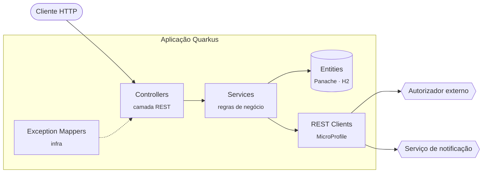
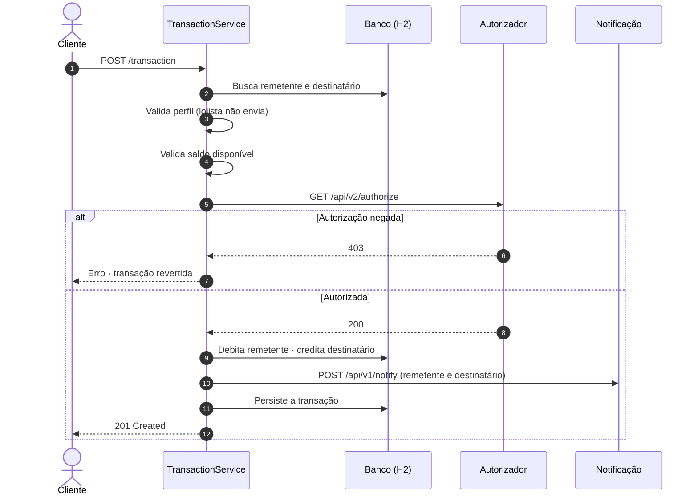

<div align="center">

<br>

# PicPay Simplificado

**Transferências entre usuários. Regras claras. Nenhum centavo fora do lugar.**

Uma API REST de pagamentos construída com Quarkus, inspirada no desafio técnico de back-end do PicPay.

<br>


<br>

[Visão geral](#visão-geral) ·
[Arquitetura](#arquitetura) ·
[Regras de negócio](#regras-de-negócio) ·
[Executando](#executando-o-projeto) ·
[API](#referência-da-api) ·
[Próximos passos](#próximos-passos)

<br>

</div>

---

## Visão geral

O PicPay Simplificado é uma plataforma de pagamentos reduzida ao essencial: **usuários com carteira** e **transferências de dinheiro entre eles**.

Existem dois perfis de usuário:

| Perfil | Envia dinheiro | Recebe dinheiro |
| :--- | :---: | :---: |
| **Comum** (`COMMON`) | ✓ | ✓ |
| **Lojista** (`MERCHANT`) | — | ✓ |

Cada transferência passa por uma cadeia de validações internas, é confirmada por um **serviço autorizador externo** e, ao final, dispara uma **notificação** para quem enviou e para quem recebeu. Tudo dentro de uma única transação de banco de dados: ou a transferência acontece por inteiro, ou não acontece.

---

## Arquitetura

O projeto segue uma arquitetura em camadas, com responsabilidades bem separadas:



| Camada | Pacote | Responsabilidade |
| :--- | :--- | :--- |
| **Controllers** | `controllers` | Expõem os endpoints REST e traduzem HTTP ↔ Java. |
| **Services** | `services` | Concentram as regras de negócio e o controle transacional (`@Transactional`). |
| **Entities** | `entitys` | Modelagem do banco com Hibernate ORM + Panache (Active Record). |
| **DTOs** | `dtos` | Contratos de entrada e saída das requisições e dos serviços externos. |
| **REST Clients** | `mocks` | Clientes declarativos (MicroProfile REST Client) para os serviços externos. |
| **Infra** | `infra` | Tratamento centralizado de exceções com respostas JSON padronizadas. |

### Estrutura de pastas

```text
src/main/java/dev/whallyson
├── controllers
│   ├── TransactionController.java      POST /transaction
│   ├── UserController.java             GET · POST /users
│   └── HelloController.java            GET /hello (health simples)
├── services
│   ├── TransactionService.java         orquestra a transferência
│   └── UserService.java                cadastro e validações de usuário
├── entitys
│   ├── user/User.java                  tabela tb_users
│   ├── user/UserType.java              COMMON | MERCHANT
│   └── transaction/Transaction.java    tabela tb_transactions
├── dtos
│   ├── requests/                       corpos de requisição
│   ├── responses/                      respostas dos serviços externos
│   └── exception/ErrorResponseDTO.java formato padrão de erro
├── mocks
│   ├── AuthorizationTransaction/       cliente do autorizador
│   └── SendNotification/               cliente de notificação
└── infra
    ├── GlobalExceptionHandler.java
    └── DataIntegrityViolationExceptionMapper.java
```

---

## Regras de negócio

### O fluxo de uma transferência



### Validações aplicadas

1. **Remetente e destinatário precisam existir** no sistema.
2. **Lojistas não enviam dinheiro**, apenas recebem.
3. **O remetente precisa ter saldo suficiente** para o valor solicitado.
4. **O autorizador externo precisa aprovar** a operação. Se ele recusar ou estiver indisponível, nada é gravado.
5. **A operação é atômica**: débito, crédito e registro da transação ocorrem na mesma transação (`@Transactional`). Qualquer falha resulta em rollback.
6. **A notificação não bloqueia a transferência**: se o serviço de notificação falhar, a transferência permanece válida e o status do envio fica registrado na própria transação (`notifySender` / `notifyReceiver`).
7. **CPF/CNPJ e e-mail são únicos** no cadastro de usuários.

### Serviços externos

| Serviço | Método | URL |
| :--- | :---: | :--- |
| Autorizador | `GET` | `https://util.devi.tools/api/v2/authorize` |
| Notificação | `POST` | `https://util.devi.tools/api/v1/notify` |

> Os dois serviços são mocks públicos do desafio. O autorizador **nega parte das requisições propositalmente**, então é normal que algumas transferências válidas sejam recusadas. Basta tentar novamente.

---

## Executando o projeto

### Pré-requisitos

- **Java 21** ou superior
- Acesso à internet (para os serviços de autorização e notificação)

O Maven não precisa estar instalado: o projeto já inclui o Maven Wrapper (`mvnw`).

### Modo desenvolvimento

```bash
./mvnw quarkus:dev
```

A aplicação sobe em `http://localhost:8080` com *live reload*. No modo dev ficam disponíveis:

| Recurso | Endereço |
| :--- | :--- |
| Swagger UI | <http://localhost:8080/q/swagger-ui> |
| Especificação OpenAPI | <http://localhost:8080/q/openapi> |
| Dev UI do Quarkus | <http://localhost:8080/q/dev-ui> |

> O banco é o **H2 em memória**, recriado a cada inicialização (`drop-and-create`). Os dados existem apenas enquanto a aplicação estiver rodando.

### Empacotando e executando

```bash
./mvnw package
java -jar target/quarkus-app/quarkus-run.jar
```

Para gerar um único JAR executável (*über-jar*):

```bash
./mvnw package -Dquarkus.package.jar.type=uber-jar
java -jar target/*-runner.jar
```

### Executável nativo (GraalVM)

```bash
./mvnw package -Dnative
# ou, sem GraalVM instalado, compilando dentro de um container:
./mvnw package -Dnative -Dquarkus.native.container-build=true

./target/picpay-simplificado-1.0.0-SNAPSHOT-runner
```

### Testes

```bash
./mvnw test       # testes com @QuarkusTest
./mvnw verify     # inclui os testes de integração sobre o artefato empacotado
```

> No Windows, use `mvnw.cmd` no lugar de `./mvnw`.

---

## Referência da API

Todas as rotas recebem e retornam `application/json`.

### `POST /users` · Cadastrar usuário

```bash
curl -X POST http://localhost:8080/users \
  -H "Content-Type: application/json" \
  -d '{
    "firstName": "Ana",
    "lastName": "Silva",
    "document": "12345678900",
    "email": "ana@email.com",
    "password": "senha-segura",
    "balance": 1000.00,
    "userType": "COMMON"
  }'
```

| Campo | Tipo | Descrição |
| :--- | :--- | :--- |
| `firstName` | `string` | Nome |
| `lastName` | `string` | Sobrenome |
| `document` | `string` | CPF ou CNPJ · **único** |
| `email` | `string` | E-mail · **único** |
| `password` | `string` | Senha |
| `balance` | `number` | Saldo inicial da carteira |
| `userType` | `string` | `COMMON` ou `MERCHANT` |

**Resposta · `201 Created`**

```json
{
  "id": 1,
  "firstName": "Ana",
  "lastName": "Silva",
  "document": "12345678900",
  "email": "ana@email.com",
  "password": "senha-segura",
  "balance": 1000.00,
  "userType": "COMMON"
}
```

### `GET /users` · Listar usuários

```bash
curl http://localhost:8080/users
```

**Resposta · `200 OK`** com a lista de usuários cadastrados.

### `POST /transaction` · Realizar transferência

```bash
curl -X POST http://localhost:8080/transaction \
  -H "Content-Type: application/json" \
  -d '{
    "senderId": 1,
    "receiverId": 2,
    "amount": 100.00
  }'
```

| Campo | Tipo | Descrição |
| :--- | :--- | :--- |
| `senderId` | `number` | ID de quem envia |
| `receiverId` | `number` | ID de quem recebe |
| `amount` | `number` | Valor da transferência |

**Resposta · `201 Created`**

```json
{
  "id": 1,
  "amount": 100.00,
  "notifySender": "Notificação enviada com sucesso",
  "notifyReceiver": "Notificação enviada com sucesso",
  "sender":   { "id": 1, "firstName": "Ana",  "balance": 900.00,  "userType": "COMMON" },
  "receiver": { "id": 2, "firstName": "Loja", "balance": 100.00,  "userType": "MERCHANT" },
  "timestamp": "2026-10-25T14:32:10.512"
}
```

<sub>Resposta resumida: os objetos `sender` e `receiver` retornam o usuário completo.</sub>

### Formato de erro

Todos os erros seguem o mesmo contrato:

```json
{
  "statusCode": 500,
  "message": "Saldo insuficiente"
}
```

| Situação | Status | Mensagem |
| :--- | :---: | :--- |
| CPF/CNPJ ou e-mail já cadastrado | `400` | `Violação de chave única no banco de dados.` |
| Remetente inexistente | `500` | `Usuário remetente não encontrado` |
| Destinatário inexistente | `500` | `Usuário destinatário não encontrado` |
| Remetente é lojista | `500` | `Usuário do tipo lojista não está autorizado a realizar transferências` |
| Saldo insuficiente | `500` | `Saldo insuficiente` |
| Autorizador recusou | `500` | `Transferência recusada pelo serviço de autorização` |

---

## Stack

| Tecnologia | Uso no projeto |
| :--- | :--- |
| **Java 21** | Linguagem |
| **Quarkus 3.15** | Framework: injeção de dependência (ArC), REST, inicialização rápida e suporte a build nativo |
| **Quarkus REST + Jackson** | Endpoints JAX-RS e serialização JSON |
| **MicroProfile REST Client** | Integração declarativa com o autorizador e o serviço de notificação |
| **Hibernate ORM + Panache** | Persistência no padrão Active Record |
| **Narayana JTA** | Controle transacional com `@Transactional` |
| **H2** | Banco relacional em memória |
| **SmallRye OpenAPI** | Documentação OpenAPI e Swagger UI |
| **JUnit 5 + REST Assured** | Testes |

---

## Próximos passos

Evoluções mapeadas para levar o projeto a um nível de produção:

- [ ] **Status HTTP semânticos** — exceções de domínio próprias, devolvendo `404` (usuário inexistente), `422` (saldo insuficiente / lojista) e `403` (não autorizado) em vez de `500`.
- [ ] **Não expor a senha** — DTOs de resposta para usuário e transação, e hash da senha com BCrypt.
- [ ] **Validação de entrada** — Bean Validation (`@NotNull`, `@Positive`, `@Email`) e validação de CPF/CNPJ.
- [ ] **Bloquear transferência para si mesmo** e valores zerados ou negativos.
- [ ] **Concorrência** — *lock* otimista (`@Version`) ou pessimista no saldo, evitando gasto duplo em requisições simultâneas.
- [ ] **Notificação assíncrona** — enviar apenas após o *commit* (evento CDI `@Observes(during = AFTER_SUCCESS)` ou fila), com *retry* e *timeout* via SmallRye Fault Tolerance.
- [ ] **URLs externas configuráveis** — mover as `baseUri` dos REST Clients para o `application.properties`.
- [ ] **Testes de regra de negócio** — testes unitários dos services e testes de integração dos fluxos com os serviços externos mockados.
- [ ] **Banco persistente** — PostgreSQL com migrações via Flyway e Docker Compose para o ambiente local.

---

<div align="center">

<br>

Desenvolvido por **Whallyson Gabriel Garcia da Silva**

<sub>Java · Quarkus · Back-end</sub>

<br>

</div>
