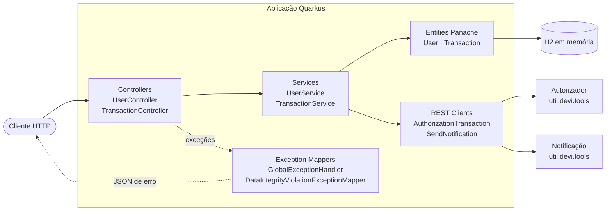
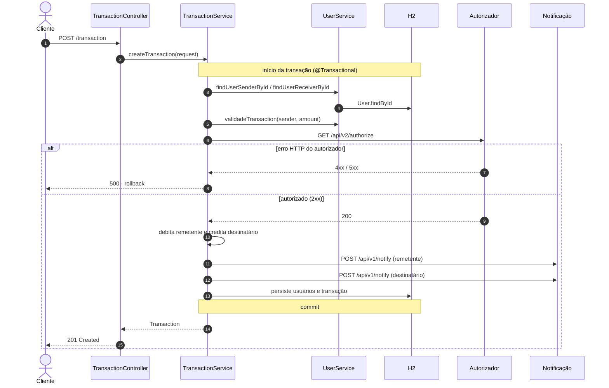
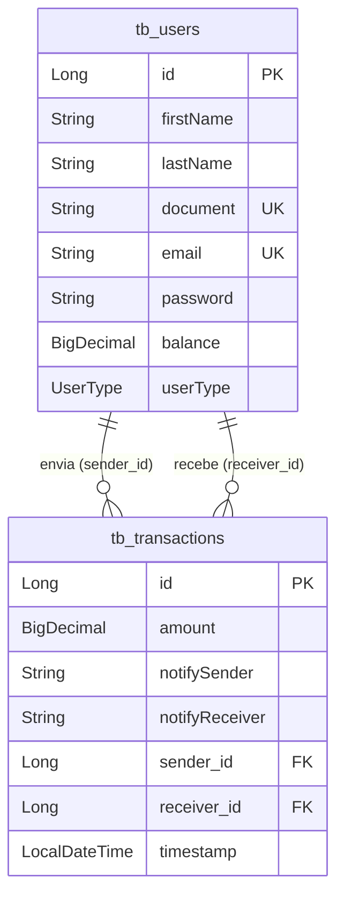

<div align="center">

<br>

# PicPay Simplificado

**API REST de transferências entre carteiras, construída com Quarkus.**

Cadastro de usuários, transferências com autorização externa e notificação de quem envia e de quem recebe. Débito, crédito e registro acontecem em uma única transação de banco de dados.

<br>


<br>

[Visão geral](#visão-geral) ·
[Funcionalidades](#funcionalidades) ·
[Regras de negócio](#regras-de-negócio) ·
[Arquitetura](#arquitetura) ·
[Execução](#instalação-e-execução) ·
[API](#referência-da-api) ·
[Limitações](#limitações-conhecidas) ·
[Roadmap](#roadmap)

<br>

</div>

---

## Sumário

- [Visão geral](#visão-geral)
- [Funcionalidades](#funcionalidades)
- [Regras de negócio](#regras-de-negócio)
- [Arquitetura](#arquitetura)
- [Tecnologias utilizadas](#tecnologias-utilizadas)
- [Pré-requisitos](#pré-requisitos)
- [Instalação e execução](#instalação-e-execução)
- [Configuração](#configuração)
- [Referência da API](#referência-da-api)
- [Persistência e modelo de dados](#persistência-e-modelo-de-dados)
- [Testes](#testes)
- [Estrutura de diretórios](#estrutura-de-diretórios)
- [Limitações conhecidas](#limitações-conhecidas)
- [Roadmap](#roadmap)
- [Como contribuir](#como-contribuir)
- [Licença](#licença)
- [Créditos](#créditos)

---

## Visão geral

O **PicPay Simplificado** é uma implementação do conhecido desafio técnico de back-end do PicPay: uma plataforma de pagamentos reduzida ao essencial, em que usuários têm uma carteira com saldo e podem transferir dinheiro entre si.

O problema central do desafio é **movimentar saldo entre duas contas de forma consistente**. Uma transferência só pode acontecer se o remetente tiver permissão e saldo, e se um serviço externo autorizar a operação. Se qualquer etapa falhar, nenhum saldo pode ser alterado.

### Como funciona

1. Os usuários são cadastrados com um saldo inicial e um perfil (`COMMON` ou `MERCHANT`).
2. Uma transferência informa remetente, destinatário e valor.
3. A aplicação valida as regras de negócio, consulta o **serviço autorizador externo** e, se aprovada, debita o remetente, credita o destinatário e registra a transação.
4. O **serviço de notificação externo** é acionado, e o resultado do envio fica registrado na própria transação.

### Perfis de usuário

| Perfil | Valor do enum | Envia transferências | Recebe transferências |
| :--- | :--- | :---: | :---: |
| Usuário comum | `COMMON` | Sim | Sim |
| Lojista | `MERCHANT` | Não | Sim |

---

## Funcionalidades

Funcionalidades implementadas no código atual:

| Funcionalidade | Endpoint |
| :--- | :--- |
| Cadastrar usuário (comum ou lojista) com saldo inicial | `POST /users` |
| Listar todos os usuários | `GET /users` |
| Realizar transferência entre usuários | `POST /transaction` |
| Endpoint simples de verificação | `GET /hello` |
| Especificação OpenAPI gerada automaticamente | `GET /q/openapi` |
| Swagger UI (somente em modo de desenvolvimento e teste) | `GET /q/swagger-ui` |

O projeto **não** possui, atualmente: autenticação, consulta de extrato ou de transações, atualização ou exclusão de usuários, estorno, nem validação de formato de CPF/CNPJ ou e-mail. Essas possibilidades estão listadas no [Roadmap](#roadmap) como propostas futuras.

---

## Regras de negócio

As regras abaixo estão implementadas em `UserService` e `TransactionService` e são verificadas nesta ordem durante uma transferência:

| # | Regra | Onde | Consequência quando violada |
| :---: | :--- | :--- | :--- |
| 1 | O remetente precisa existir | `UserService.findUserSenderById` | Erro `Usuário remetente não encontrado` |
| 2 | O destinatário precisa existir | `UserService.findUserReceiverById` | Erro `Usuário destinatário não encontrado` |
| 3 | Lojistas (`MERCHANT`) não podem enviar | `UserService.validadeTransaction` | Erro `Usuário do tipo lojista não está autorizado a realizar transferências` |
| 4 | O saldo do remetente precisa ser maior ou igual ao valor | `UserService.validadeTransaction` | Erro `Saldo insuficiente` |
| 5 | O autorizador externo precisa responder com sucesso (HTTP 2xx) | `TransactionService.authorizeTransaction` | Erro `Transferência recusada pelo serviço de autorização` |

Comportamentos adicionais:

- **Atomicidade.** `createTransaction` é anotado com `@Transactional`. Uma exceção em qualquer etapa provoca *rollback*, e nenhum saldo é alterado.
- **Notificação não bloqueante.** Se o serviço de notificação responder com erro HTTP, a transferência é concluída mesmo assim. O resultado fica nos campos `notifySender` e `notifyReceiver` da transação: `Notificação enviada com sucesso` ou `Falha ao enviar a notificação`.
- **Unicidade de cadastro.** Os campos `document` e `email` têm restrição `UNIQUE` no banco. Um cadastro duplicado retorna `400`.
- **Diferença entre perfis.** O perfil só interfere no **envio**. Um lojista pode receber transferências normalmente, mas qualquer tentativa de enviar é recusada antes da consulta ao autorizador.

> **Importante:** o autorizador é avaliado apenas pelo **código HTTP** da resposta. O campo `data.authorization` do corpo é desserializado, mas não é verificado.

---

## Arquitetura

A aplicação segue uma arquitetura em camadas, com o Quarkus provendo injeção de dependência (CDI/ArC), camada REST (JAX-RS) e controle transacional (JTA).



### Camadas e responsabilidades

| Camada | Pacote | Responsabilidade |
| :--- | :--- | :--- |
| API (apresentação) | `controllers` | Recursos JAX-RS. Recebem JSON, delegam aos serviços e devolvem `201 Created` ou `200 OK`. |
| Serviços | `services` | Regras de negócio, orquestração da transferência e demarcação transacional com `@Transactional`. |
| Entidades | `entitys` | Modelo persistente com Hibernate ORM + Panache no padrão *Active Record* (`PanacheEntityBase`). |
| DTOs | `dtos` | Corpo da requisição de transferência, contratos dos serviços externos e formato padrão de erro. |
| Integrações | `mocks` | Interfaces MicroProfile REST Client para o autorizador e para o serviço de notificação. |
| Infraestrutura | `infra` | `ExceptionMapper`s que convertem exceções em respostas JSON. |

### Tratamento de exceções

Há dois mapeadores registrados com `@Provider`:

| Mapeador | Captura | Resposta |
| :--- | :--- | :--- |
| `DataIntegrityViolationExceptionMapper` | `PersistenceException` | `400` com mensagem de integridade de dados |
| `GlobalExceptionHandler` | `Exception` (todas as demais) | `500` com a mensagem da exceção |

As regras de negócio lançam `java.lang.Exception` genérica, por isso **todos os erros de negócio retornam `500`**. Detalhes em [Limitações conhecidas](#limitações-conhecidas).

### Fluxo principal: transferência



As duas chamadas de notificação ocorrem **antes do commit**, ainda dentro da transação.

---

## Tecnologias utilizadas

### Execução

| Tecnologia | Versão | Finalidade |
| :--- | :--- | :--- |
| Java | 21 (`maven.compiler.release`) | Linguagem e plataforma |
| Quarkus | 3.15.1 (BOM `quarkus-bom`) | Framework da aplicação |
| Quarkus ArC | gerenciada pelo BOM | Injeção de dependência (CDI) |
| Quarkus REST + REST Jackson | gerenciada pelo BOM | Endpoints JAX-RS e serialização JSON |
| Quarkus REST Client + REST Client Jackson | gerenciada pelo BOM | Clientes declarativos dos serviços externos |
| Hibernate ORM com Panache | gerenciada pelo BOM | Mapeamento objeto-relacional no padrão *Active Record* |
| Narayana JTA | gerenciada pelo BOM (transitiva) | Suporte a `@Transactional` |
| H2 (`quarkus-jdbc-h2`) | gerenciada pelo BOM | Banco relacional em memória |
| SmallRye OpenAPI | gerenciada pelo BOM | Especificação OpenAPI e Swagger UI |

### Desenvolvimento e build

| Tecnologia | Versão | Finalidade |
| :--- | :--- | :--- |
| Maven (via Maven Wrapper) | 3.9.8 / wrapper 3.3.2 | Build e gerenciamento de dependências |
| Maven Compiler Plugin | 3.13.0 | Compilação |
| Maven Surefire / Failsafe | 3.3.1 | Testes e testes de integração |
| JUnit 5 (`quarkus-junit5`) | gerenciada pelo BOM | Framework de testes |
| REST Assured | gerenciada pelo BOM | Testes de API HTTP |

---

## Pré-requisitos

| Requisito | Detalhe |
| :--- | :--- |
| JDK 21 | O projeto compila com `release 21`. |
| Acesso à internet | No primeiro build, para baixar o Maven e as dependências. Em execução, para alcançar os serviços externos em `util.devi.tools`. |
| Git | Para clonar o repositório. |
| GraalVM ou Docker/Podman | Somente para a compilação nativa (opcional). |

Não é necessário instalar o Maven: o Maven Wrapper (`mvnw` / `mvnw.cmd`) baixa a versão configurada automaticamente. Também não é necessário instalar banco de dados, porque o H2 roda em memória dentro da aplicação.

---

## Instalação e execução

### 1. Obter o código

```bash
git clone https://github.com/WhallysonGGDS/Desafio-picpay-quarkus.git
cd Desafio-picpay-quarkus
```

### 2. Modo de desenvolvimento

Inicia a aplicação com *live reload*: alterações no código são recarregadas automaticamente.

```bash
./mvnw quarkus:dev
```

A API fica disponível em `http://localhost:8080`. No modo de desenvolvimento também estão disponíveis:

| Recurso | Endereço |
| :--- | :--- |
| Swagger UI | <http://localhost:8080/q/swagger-ui> |
| Especificação OpenAPI | <http://localhost:8080/q/openapi> |
| Dev UI do Quarkus | <http://localhost:8080/q/dev-ui> |

> No Windows, use `mvnw.cmd` no lugar de `./mvnw` em todos os comandos.

### 3. Executar os testes

```bash
./mvnw test
```

Detalhes na seção [Testes](#testes).

### 4. Empacotar

Gera o artefato em `target/quarkus-app/`:

```bash
./mvnw package
```

Para gerar um único JAR com todas as dependências (*über-jar*):

```bash
./mvnw package -Dquarkus.package.jar.type=uber-jar
```

### 5. Executar o artefato gerado

```bash
# pacote padrão (fast-jar)
java -jar target/quarkus-app/quarkus-run.jar

# über-jar
java -jar target/picpay-simplificado-1.0.0-SNAPSHOT-runner.jar
```

Fora do modo de desenvolvimento o Swagger UI não é incluído, mas a especificação continua disponível em `/q/openapi`.

### 6. Compilação nativa (opcional)

O `pom.xml` define o perfil `native`, ativado pela propriedade `-Dnative`:

```bash
# com GraalVM instalada localmente
./mvnw package -Dnative

# sem GraalVM, compilando dentro de um container
./mvnw package -Dnative -Dquarkus.native.container-build=true

# executar o binário gerado
./target/picpay-simplificado-1.0.0-SNAPSHOT-runner
```

> A compilação nativa está configurada no projeto, mas não foi executada na validação desta documentação.

---

## Configuração

O projeto não usa arquivo `.env` nem variáveis de ambiente próprias. A configuração está em `src/main/resources/application.properties`:

| Propriedade | Valor atual | Finalidade |
| :--- | :--- | :--- |
| `quarkus.datasource.db-kind` | `h2` | Tipo de banco de dados |
| `quarkus.datasource.jdbc.url` | `jdbc:h2:mem:picpay` | Banco H2 em memória (os dados se perdem ao encerrar a aplicação) |
| `quarkus.datasource.username` | `sa` | Usuário padrão do H2 local |
| `quarkus.datasource.password` | *(vazio)* | Senha do H2 local |
| `quarkus.hibernate-orm.database.generation` | `drop-and-create` | Recria o esquema a cada inicialização |
| `quarkus.hibernate-orm.dialect` | `org.hibernate.dialect.H2Dialect` | Dialeto SQL |
| `quarkus.hibernate-orm.log.sql` | `false` | Log das instruções SQL |
| `quarkus.hibernate-orm.log.bind-parameters` | `false` | Log dos parâmetros das instruções SQL |

As credenciais acima são as padrão de um banco H2 em memória local, não de um ambiente real.

### Serviços externos

As URLs base dos clientes REST estão definidas nas anotações `@RegisterRestClient(baseUri = "https://util.devi.tools")`:

| Cliente | Método | Endpoint |
| :--- | :---: | :--- |
| `AuthorizationTransaction` | `GET` | `https://util.devi.tools/api/v2/authorize` |
| `SendNotification` | `POST` | `https://util.devi.tools/api/v1/notify` |

### Sobrescrevendo propriedades

Como em qualquer aplicação Quarkus, as propriedades podem ser sobrescritas na inicialização com `-D`. Exemplos:

```bash
# alterar a porta HTTP
java -Dquarkus.http.port=8090 -jar target/quarkus-app/quarkus-run.jar

# apontar o cliente de autorização para outro endereço
java -Dquarkus.rest-client.\"dev.whallyson.mocks.AuthorizationTransaction.AuthorizationTransaction\".url=http://localhost:9000 \
     -jar target/quarkus-app/quarkus-run.jar
```

---

## Referência da API

- **URL base:** `http://localhost:8080`
- **Formato:** todas as rotas de negócio consomem e produzem `application/json`.
- **Autenticação:** não há.
- **Cabeçalho obrigatório nas requisições `POST`:** `Content-Type: application/json`. Sem ele, a resposta é `500` com a mensagem `The content-type header value did not match the value in @Consumes`.

Os exemplos abaixo usam dados fictícios.

### Resumo

| Método | Caminho | Finalidade | Sucesso |
| :---: | :--- | :--- | :---: |
| `GET` | `/users` | Listar usuários | `200` |
| `POST` | `/users` | Cadastrar usuário | `201` |
| `POST` | `/transaction` | Realizar transferência | `201` |
| `GET` | `/hello` | Verificação simples (texto) | `200` |

---

### `POST /users`

Cadastra um usuário. O corpo é desserializado diretamente na entidade `User`.

**Corpo da requisição**

| Campo | Tipo | Observação |
| :--- | :--- | :--- |
| `firstName` | `string` | Nome |
| `lastName` | `string` | Sobrenome |
| `document` | `string` | CPF ou CNPJ. Único no banco. |
| `email` | `string` | Único no banco. |
| `password` | `string` | Armazenada e retornada em texto puro. |
| `balance` | `number` | Saldo inicial. |
| `userType` | `string` | `COMMON` ou `MERCHANT`. |

Nenhum campo é validado como obrigatório pela aplicação. Veja [Limitações conhecidas](#limitações-conhecidas).

**Exemplo**

```bash
curl -X POST http://localhost:8080/users \
  -H "Content-Type: application/json" \
  -d '{
    "firstName": "Maria",
    "lastName": "Souza",
    "document": "00000000001",
    "email": "maria@exemplo.com",
    "password": "exemplo123",
    "balance": 500.00,
    "userType": "COMMON"
  }'
```

**Resposta `201 Created`**

```json
{
  "id": 1,
  "firstName": "Maria",
  "lastName": "Souza",
  "document": "00000000001",
  "email": "maria@exemplo.com",
  "password": "exemplo123",
  "balance": 500.00,
  "userType": "COMMON"
}
```

**Erros**

| Situação | Status | Corpo |
| :--- | :---: | :--- |
| `document` ou `email` já cadastrado | `400` | `{"statusCode":400,"message":"Violação de chave única no banco de dados."}` |
| `userType` com valor fora do enum | `400` | corpo vazio |
| JSON malformado | `500` | `{"statusCode":500,"message":"HTTP 400 Bad Request"}` |

---

### `GET /users`

Retorna todos os usuários cadastrados, incluindo o campo `password`.

```bash
curl http://localhost:8080/users
```

**Resposta `200 OK`**

```json
[
  {
    "id": 1,
    "firstName": "Maria",
    "lastName": "Souza",
    "document": "00000000001",
    "email": "maria@exemplo.com",
    "password": "exemplo123",
    "balance": 500.00,
    "userType": "COMMON"
  },
  {
    "id": 2,
    "firstName": "Loja",
    "lastName": "Exemplo",
    "document": "00000000000100",
    "email": "loja@exemplo.com",
    "password": "exemplo123",
    "balance": 0,
    "userType": "MERCHANT"
  }
]
```

---

### `POST /transaction`

Transfere um valor do remetente para o destinatário seguindo as [regras de negócio](#regras-de-negócio).

**Corpo da requisição** (`RequestTransaction`)

| Campo | Tipo | Observação |
| :--- | :--- | :--- |
| `senderId` | `number` (Long) | ID do remetente |
| `receiverId` | `number` (Long) | ID do destinatário |
| `amount` | `number` (BigDecimal) | Valor a transferir |

**Exemplo**

```bash
curl -X POST http://localhost:8080/transaction \
  -H "Content-Type: application/json" \
  -d '{
    "senderId": 1,
    "receiverId": 2,
    "amount": 100.00
  }'
```

**Resposta `201 Created`**

Resposta real obtida com os usuários do exemplo anterior. Neste caso o serviço de notificação estava indisponível, por isso os campos de notificação registram a falha:

```json
{
  "id": 1,
  "amount": 100.00,
  "notifySender": "Falha ao enviar a notificação",
  "notifyReceiver": "Falha ao enviar a notificação",
  "sender": {
    "id": 1,
    "firstName": "Maria",
    "lastName": "Souza",
    "document": "00000000001",
    "email": "maria@exemplo.com",
    "password": "exemplo123",
    "balance": 400.00,
    "userType": "COMMON"
  },
  "receiver": {
    "id": 2,
    "firstName": "Loja",
    "lastName": "Exemplo",
    "document": "00000000000100",
    "email": "loja@exemplo.com",
    "password": "exemplo123",
    "balance": 100.00,
    "userType": "MERCHANT"
  },
  "timestamp": "2026-10-25T01:54:45.371088"
}
```

Quando a notificação é aceita, os campos `notifySender` e `notifyReceiver` trazem `Notificação enviada com sucesso`.

**Erros**

Todos os erros de negócio retornam `500` no formato `ErrorResponseDTO`:

| Situação | Status | `message` |
| :--- | :---: | :--- |
| Remetente inexistente | `500` | `Usuário remetente não encontrado` |
| Destinatário inexistente | `500` | `Usuário destinatário não encontrado` |
| Remetente é lojista | `500` | `Usuário do tipo lojista não está autorizado a realizar transferências` |
| Saldo insuficiente | `500` | `Saldo insuficiente` |
| Autorizador respondeu com erro HTTP | `500` | `Transferência recusada pelo serviço de autorização` |
| Autorizador inacessível (falha de conexão) | `500` | mensagem técnica da exceção de rede |
| `amount` ausente | `500` | `Cannot read field "scale" because "val" is null` |
| `senderId` ausente | `500` | `id to load is required for loading` |

> O autorizador público do desafio **recusa parte das requisições propositalmente** (responde `403`). É esperado que uma transferência válida às vezes seja negada. Basta repetir a requisição.

---

### `GET /hello`

Endpoint herdado do projeto inicial do Quarkus. Retorna texto puro e é usado pelos testes automatizados.

```bash
curl http://localhost:8080/hello
```

```text
Hello from Quarkus REST
```

---

### Formato padrão de erro

As respostas produzidas pelos mapeadores de exceção seguem o contrato de `ErrorResponseDTO`:

```json
{
  "statusCode": 500,
  "message": "Saldo insuficiente"
}
```

O campo `statusCode` repete o código HTTP da resposta.

---

## Persistência e modelo de dados

A persistência usa **Hibernate ORM com Panache** no padrão *Active Record*: as entidades estendem `PanacheEntityBase` e expõem métodos como `persist()`, `findById()` e `listAll()`. O banco é o **H2 em memória**, e o esquema é recriado a cada inicialização.



### `User` · tabela `tb_users`

Representa uma conta com carteira.

- `id`: chave primária gerada pelo banco (`GenerationType.IDENTITY`).
- `document` e `email`: restrição `UNIQUE`.
- `balance`: saldo da carteira (`BigDecimal`).
- `userType`: enum `UserType` gravado como texto (`EnumType.STRING`).

### `Transaction` · tabela `tb_transactions`

Registro de uma transferência concluída.

- `sender` e `receiver`: relacionamentos `@ManyToOne` com `User`, nas colunas `sender_id` e `receiver_id`. Um usuário pode participar de várias transações.
- `notifySender` e `notifyReceiver`: texto com o resultado das notificações.
- `timestamp`: data e hora de criação, preenchidas automaticamente por `@CreationTimestamp`.

---

## Testes

```bash
# testes com @QuarkusTest
./mvnw test

# testes + testes de integração sobre o artefato empacotado
./mvnw verify -DskipITs=false
```

O `pom.xml` define `skipITs=true`, então `./mvnw verify` sozinho não executa os testes de integração. O perfil `native` habilita esses testes automaticamente.

| Classe | Tipo | O que verifica |
| :--- | :--- | :--- |
| `GreetingResourceTest` | `@QuarkusTest` | `GET /hello` retorna `200` com `Hello from Quarkus REST` |
| `GreetingResourceIT` | `@QuarkusIntegrationTest` | O mesmo teste, executado contra o artefato empacotado |

Os dois comandos acima foram executados com sucesso na validação desta documentação (1 teste em cada fase, sem falhas).

**Escopo atual:** os testes cobrem apenas o endpoint `/hello`. Cadastro de usuários, transferências, regras de negócio e tratamento de erros **não possuem testes automatizados** até o momento.

---

## Estrutura de diretórios

```text
Desafio-picpay-quarkus/
├── .mvn/wrapper/                      configuração do Maven Wrapper
├── mvnw · mvnw.cmd                    Maven Wrapper (Linux/macOS · Windows)
├── pom.xml                            dependências, plugins e perfil native
└── src/
    ├── main/
    │   ├── java/dev/whallyson/
    │   │   ├── controllers/
    │   │   │   ├── UserController.java            GET e POST /users
    │   │   │   ├── TransactionController.java     POST /transaction
    │   │   │   └── HelloController.java           GET /hello
    │   │   ├── services/
    │   │   │   ├── UserService.java               cadastro, busca e validações
    │   │   │   └── TransactionService.java        orquestração da transferência
    │   │   ├── entitys/
    │   │   │   ├── user/User.java                 entidade tb_users
    │   │   │   ├── user/UserType.java             enum COMMON | MERCHANT
    │   │   │   └── transaction/Transaction.java   entidade tb_transactions
    │   │   ├── dtos/
    │   │   │   ├── requests/                      RequestTransaction, RequestSendNotification
    │   │   │   ├── responses/                     respostas dos serviços externos
    │   │   │   └── exception/ErrorResponseDTO.java
    │   │   ├── mocks/
    │   │   │   ├── AuthorizationTransaction/      REST Client do autorizador
    │   │   │   └── SendNotification/              REST Client de notificação
    │   │   └── infra/
    │   │       ├── GlobalExceptionHandler.java
    │   │       └── DataIntegrityViolationExceptionMapper.java
    │   └── resources/
    │       └── application.properties         datasource e Hibernate
    └── test/java/dev/whallyson/
        ├── GreetingResourceTest.java
        └── GreetingResourceIT.java
```

---

## Limitações conhecidas

### Confirmadas

Observadas na leitura do código e reproduzidas com a aplicação em execução:

- **Status HTTP genéricos.** Erros de negócio retornam `500`, porque são lançados como `Exception` e capturados pelo `GlobalExceptionHandler`.
- **Erros do próprio framework também viram `500`.** O mapeador de `Exception` captura exceções HTTP do JAX-RS: uma rota inexistente retorna `500` com `HTTP 404 Not Found`, e um método não suportado retorna `500` com `HTTP 405 Method Not Allowed`.
- **Senha exposta.** O campo `password` é gravado em texto puro e aparece nas respostas de `/users` e `/transaction`.
- **Sem validação de entrada.** É possível cadastrar um usuário com todos os campos nulos (`POST /users` com `{}` retorna `201`).
- **Transferência para si mesmo.** Uma transferência com `senderId` igual a `receiverId` é aceita e registrada.
- **Mensagem de duplicidade genérica.** O mapeador procura os nomes de restrição `tb_users_document_key` e `tb_users_email_key`, que não correspondem aos nomes gerados pelo H2. Por isso a resposta é sempre `Violação de chave única no banco de dados.`, sem indicar qual campo está duplicado.
- **Autorização avaliada só pelo código HTTP.** O campo `data.authorization` da resposta do autorizador não é verificado.
- **Notificação antes do commit.** As notificações são enviadas dentro da transação, antes da persistência, e com corpo vazio (`email` e `mensagem` nulos).
- **Swagger UI ausente fora do modo dev.** No JAR empacotado, `/q/swagger-ui` não existe e, pelo mapeador global, responde `500`.
- **Dados voláteis.** O H2 em memória com `drop-and-create` descarta todos os dados ao reiniciar.

### Identificadas no código, não reproduzidas

- **Valores negativos ou zero.** Não há verificação de `amount > 0`. Pela lógica de `validadeTransaction`, um valor negativo passaria pela validação de saldo e, se autorizado, inverteria o sentido da transferência.
- **Falha de rede na notificação.** Apenas `ClientWebApplicationException` (resposta HTTP de erro) é tratada. Uma falha de conexão com o serviço de notificação provavelmente se propagaria e desfaria a transferência inteira.
- **Concorrência.** Não há controle de concorrência (`@Version` ou *lock*) sobre o saldo. Transferências simultâneas do mesmo remetente podem resultar em saldo inconsistente.

---

## Roadmap

Propostas de evolução. **Nenhum destes itens está implementado.**

- [ ] Exceções de domínio com status semânticos (`404`, `422`, `403`) e mapeador que preserve as exceções HTTP do JAX-RS.
- [ ] DTOs de entrada e saída para usuário e transação, sem expor a senha.
- [ ] Hash de senha (por exemplo, BCrypt).
- [ ] Bean Validation (`@NotNull`, `@Positive`, `@Email`) e validação de CPF/CNPJ.
- [ ] Bloqueio de transferência para si mesmo e de valores menores ou iguais a zero.
- [ ] Verificação do campo `data.authorization` na resposta do autorizador.
- [ ] Controle de concorrência sobre o saldo.
- [ ] Envio de notificação após o commit, com o conteúdo da mensagem, *timeout* e *retry*.
- [ ] URLs dos serviços externos definidas em `application.properties`.
- [ ] Testes unitários e de integração para as regras de negócio.
- [ ] Banco persistente (por exemplo, PostgreSQL) com migrações versionadas.
- [ ] Endpoints de consulta de transações.

---

## Como contribuir

1. Faça um *fork* do repositório.
2. Crie uma branch a partir de `master`: `git checkout -b minha-melhoria`.
3. Faça as alterações e garanta que os testes passam: `./mvnw verify -DskipITs=false`.
4. Faça o commit com uma mensagem descritiva.
5. Abra um *pull request* explicando o que mudou e por quê.

---

## Licença

O repositório não define uma licença até o momento. Na ausência de licença, todos os direitos são reservados ao autor.

---

## Créditos

- Projeto inspirado no desafio técnico de back-end do **PicPay**.
- Serviços de autorização e notificação simulados disponibilizados em `util.devi.tools`.
- Construído com [Quarkus](https://quarkus.io/). Guias usados como referência: [REST](https://quarkus.io/guides/rest), [REST Client](https://quarkus.io/guides/rest-client), [Hibernate ORM com Panache](https://quarkus.io/guides/hibernate-orm-panache) e [OpenAPI e Swagger UI](https://quarkus.io/guides/openapi-swaggerui).

---

<div align="center">

<br>

Desenvolvido por **Whallyson Gabriel Garcia da Silva**

<sub>Java · Quarkus · Back-end</sub>

<br>

</div>
